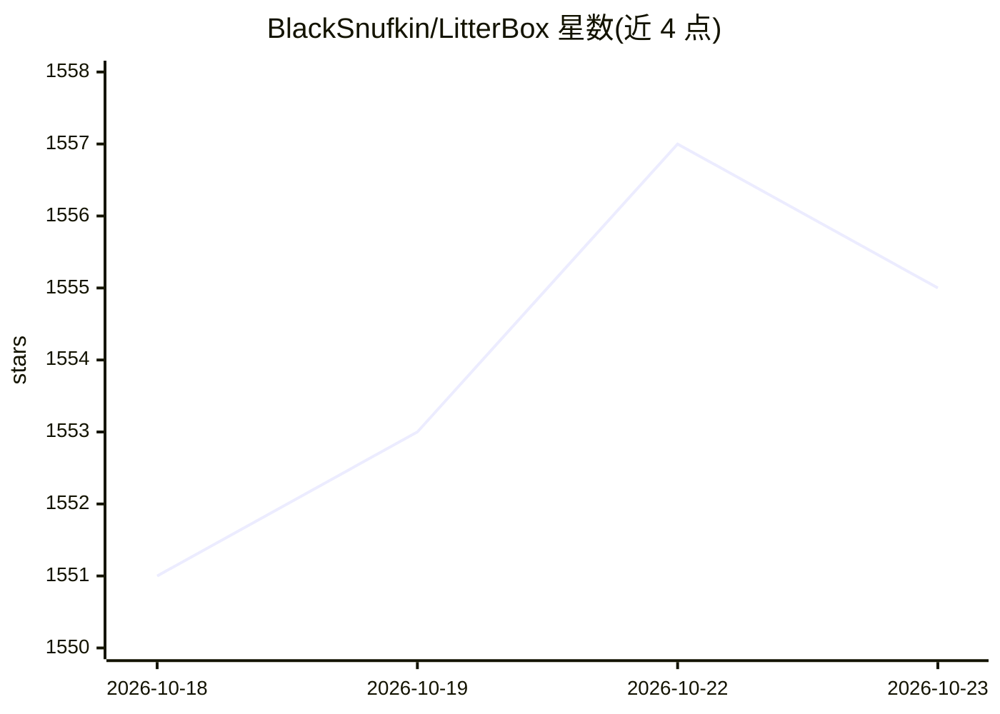

# BlackSnufkin/LitterBox

⭐ 1,555 · YARA · GPL-3.0 · 推送 2026-05-05 · [GitHub](https://github.com/BlackSnufkin/LitterBox) · 个人维护

**红队自托管载荷分析沙箱：检测评分判断 payload 可用性**

供红队（也可用于蓝队恶意软件分析）的自托管载荷分析平台：上传样本后运行静态、动态及 EDR 检测，内置 PE-Sieve、Hollows-Hunter、YARA 等 12 个扫描器及其版本追踪，输出 Detection Score 与触发指标明细；可分发载荷到装有 Elastic Defend 或 Fibratus 的 Windows VM 并回收告警。通过 MCP 让 LLM agent 驱动端到端分析，另提供 CLI 与 Python 库。Windows 源码运行需 Python 3.11+ 与管理员权限，Linux 经 Docker 部署 Windows 10 容器需 KVM，声明仅限隔离测试环境使用。

## 筛选速览

| 维度 | 判定 | 备注 |
|---|---|---|
| AI 角色 | `ai-enhanced` | 去掉 AI 部分产品仍成立 |
| 许可风险 | `viral` | GPL-3.0 |
| 部署形态 | `desktop` | 安装包/桌面程序 |
| 模型依赖 | — | README 未给出锁定关系 |
| 硬件要求 | — | 无带数字的原话,不猜 |
| 安装摩擦 | `low` | 无编译、无系统依赖或容器化 |
| 成熟度 | — | 结构信号不足 |

## 能力要点

- 静态/动态/EDR 分析管线与 Detection Score 评分
- 可分发载荷至 Elastic Defend / Fibratus 加持的 EDR VM 并回收告警
- 内置 12 个扫描器二进制及版本与更新日期追踪
- 提供 MCP、CLI（GrumpyCats）与 Python 库三种驱动方式

## 适用场景

- 部署前测试 payload 是否会被现代检测手段发现
- 在受控 EDR 环境中做恶意软件分析与告警关联
- 让 LLM agent 通过 MCP 自动化完成载荷分析流程

## 场景标签

`网络安全` · 领域:学习与行业

## 证据(README 行号)

> L13: A self-hosted payload-analysis sandbox for red teams. Upload a sample, run static / dynamic / EDR analysis against 
> L30: |CLI / Python lib / MCP for LLMs|GrumpyCats CLI · GrumpyCats Library · LitterBoxMCP|

## 星数曲线

2026-10-18 1,551 → 2026-10-23 1,555（+4）

---
*卡片 v1 · prompt 1.4 · 生成 2026-10-21 · 置信度 mid · 依据 README sha `a3882b0a015b` · [字段定义](../../DATASET.md)*
