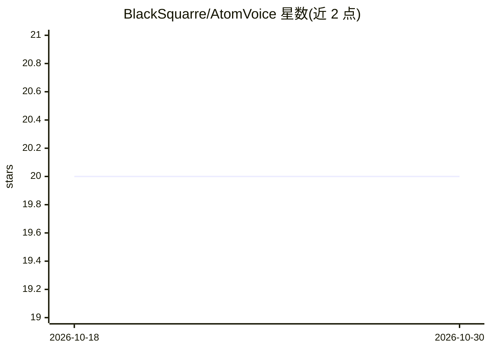

# BlackSquarre/AtomVoice

⭐ 20 · Swift · NOASSERTION · 推送 2026-10-04 · [GitHub](https://github.com/BlackSquarre/AtomVoice) · [官网](https://blacksquarre.github.io/AtomVoice/) · 个人维护 · 中文 README

**macOS 菜单栏语音听写应用：按键说话转文字进任意应用**

面向 Mac 用户的本地优先语音听写工具：按住或点按触发键说话，识别文本注入任意应用，无时长限制。提供三种识别引擎：Apple Speech（可选设备端）、Sherpa-ONNX 全离线（CPU/CoreML、模型按需下载）、豆包云端 ASR（可选，需 API Key）。可选 LLM Refinement 文本后处理，支持 OpenAI/Anthropic 兼容 API 等 10 个预设。App 包小于 3MB，不运行后台守护进程，不保留录音或转写历史。要求 macOS 14+，需辅助功能/麦克风/语音识别权限；未公证，首次打开需手动放行。

## 筛选速览

| 维度 | 判定 | 备注 |
|---|---|---|
| AI 角色 | `ai-native` | 本体是模型或模型工具 |
| 许可风险 | `permissive` | NOASSERTION |
| 部署形态 | `None` |  |
| 模型依赖 | — | README 未给出锁定关系 |
| 硬件要求 | — | 无带数字的原话,不猜 |
| 安装摩擦 | `low` | 无编译、无系统依赖或容器化 |
| 成熟度 | — | 结构信号不足 |

## 能力要点

- 三种识别引擎：Apple Speech、Sherpa-ONNX 全离线、豆包云端 ASR
- 可选 LLM Refinement 文本润色，支持 10 个预设 provider 含本地 Ollama
- App 包小于 3MB、无后台守护进程、不存储录音与转写历史
- 通过 GitHub Releases 自动更新，带 SHA256 与签名校验

## 适用场景

- 在任意 Mac 应用中用语音代替打字输入
- 离线/隐私优先场景下的本地语音听写
- 长句与中英混输时的跨应用语音写作

## 场景标签

`语音识别` · 领域:感知与多模态

## 证据(README 行号)

> L8:  Lightweight, privacy-first voice dictation that types into any Mac app, with no time limit.
> L34: - **Apple Speech Recognition** — system engine with streaming, optional on-device mode, and **segmented rolling** t
> L35: - **Sherpa-ONNX** — fully offline local engine with language-specific model presets, CPU/CoreML backends, on-demand

## 星数曲线

2026-10-18 20 → 2026-10-30 20（+0）

---
*卡片 v1 · prompt 1.4 · 生成 2026-10-28 · 置信度 high · 依据 README sha `9f38bff1312c` · [字段定义](../../DATASET.md)*
