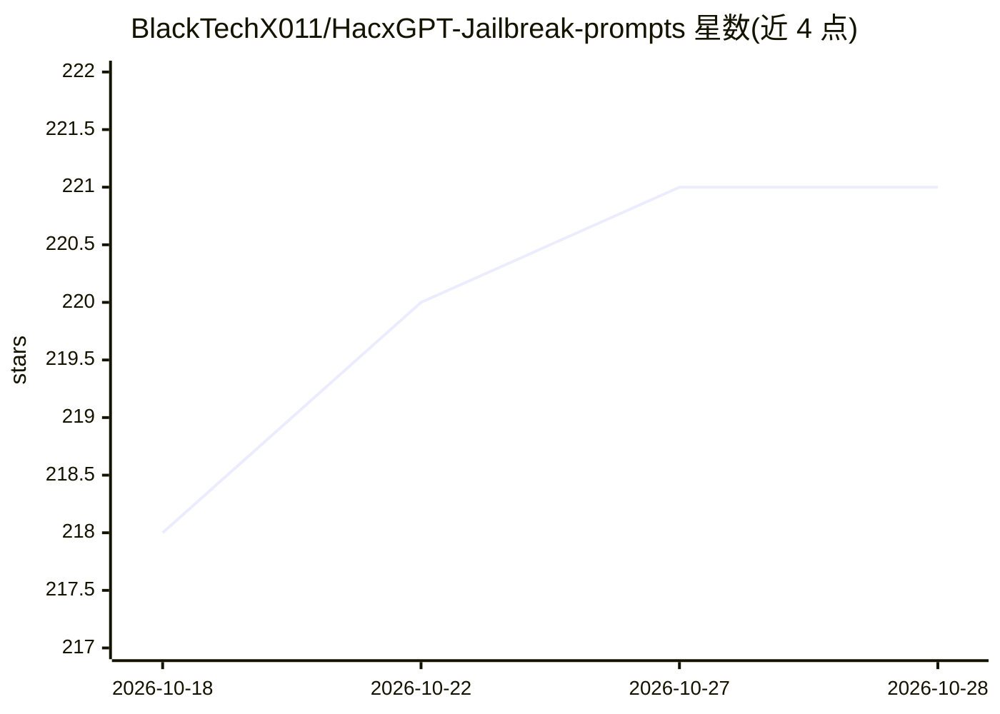

# BlackTechX011/HacxGPT-Jailbreak-prompts

⭐ 221 · MIT · 推送 2026-03-15 · [GitHub](https://github.com/BlackTechX011/HacxGPT-Jailbreak-prompts) · [官网](https://github.com/BlackTechX011/HacxGPT-Jailbreak-prompts) · 个人维护

**LLM 越狱提示词研究集合：记录绕过模型安全协议的提示技术**

以研究为定位的提示词集合，核心是 HacxGPT 人格提示：通过系统指令覆写、人格锁定、强制性命令与伦理概念置空等分层策略，覆盖模型的默认安全协议。文档方法论包括英文直接人格注入与语言混淆变体（俄语、祖鲁语等低资源语言翻译），并在 README 顶部声明仅限教育与安全研究用途。仓库不含代码或可运行程序，仅提供提示词文本与机制说明，MIT 许可、状态标注为 Research。

## 筛选速览

| 维度 | 判定 | 备注 |
|---|---|---|
| AI 角色 | `ai-knowledge` | 知识聚合/清单类 |
| 许可风险 | `permissive` | MIT |
| 部署形态 | `None` |  |
| 模型依赖 | — | README 未给出锁定关系 |
| 硬件要求 | — | 无带数字的原话,不猜 |
| 安装摩擦 | `low` | 无编译、无系统依赖或容器化 |
| 成熟度 | — | 结构信号不足 |

## 能力要点

- HacxGPT 人格提示：系统覆写+人格锁定+强制命令的分层构造
- 语言混淆方法论：俄语、祖鲁语等低资源语言翻译变体
- README 明确声明仅限教育与安全研究用途

## 适用场景

- 研究 LLM 对齐与安全机制中的提示层漏洞
- 在受控环境中测试自家模型的越狱抵抗能力

## 场景标签

`提示工程` `网络安全` · 领域:Agent 开发

## 证据(README 行号)

> L1: # HacxGPT: An Exploration into LLM Jailbreaking Techniques
> L4: Status: Research
> L7: This repository serves as a research project dedicated to exploring the mechanics of jailbreaking Large Language Mod

## 星数曲线

2026-10-18 218 → 2026-10-28 221（+3）

---
*卡片 v1 · prompt 1.4 · 生成 2026-10-22 · 置信度 high · 依据 README sha `c00bc83ce507` · [字段定义](../../DATASET.md)*
