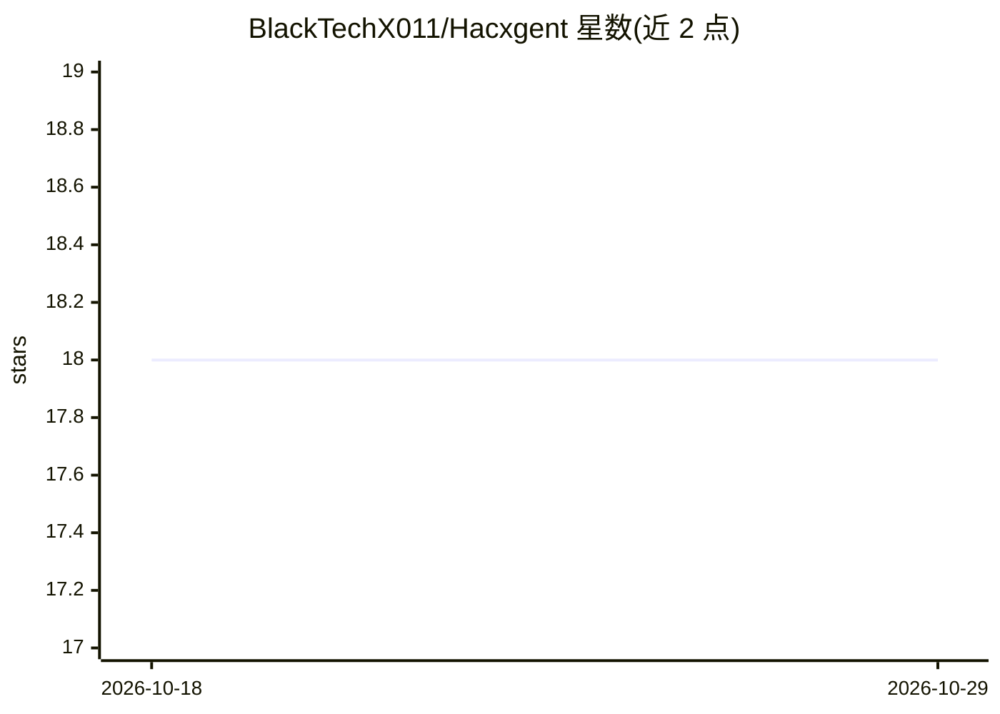

# BlackTechX011/Hacxgent

⭐ 18 · Python · Apache-2.0 · 推送 2026-02-22 · [GitHub](https://github.com/BlackTechX011/Hacxgent) · 个人维护

**面向开发者的自主 CLI 编码 agent，支持多模型接入**

终端中的自主编码代理，面向开发者执行结构分析、代码修改与长任务。核心机制是 Rolling Compaction：读取大文件后将冗长输出替换为简短标记以压缩上下文，并支持子代理并行委派任务。通过 JSON 配置接入 OpenAI、Anthropic、Ollama、Groq 或任意 OpenAI 兼容端点。内置按风险等级划分的四种 agent 配置，提供文件操作、bash、grep、影响分析等工具，并支持 Skills 系统与 MCP 协议扩展。以 pip/uv 安装，Apache-2.0 许可。

## 筛选速览

| 维度 | 判定 | 备注 |
|---|---|---|
| AI 角色 | `ai-ecosystem` | LLM/agent 周边工具 |
| 许可风险 | `permissive` | Apache-2.0 |
| 部署形态 | `library` | 以包/库形式分发 |
| 模型依赖 | local-ok | 支持本地模型 |
| 硬件要求 | — | 无带数字的原话,不猜 |
| 安装摩擦 | `low` | 无编译、无系统依赖或容器化 |
| 成熟度 | — | 结构信号不足 |

## 能力要点

- Rolling Compaction 压缩上下文以支持长任务执行
- 通过 JSON 配置接入 OpenAI/Anthropic/Ollama/Groq 等 provider
- 四种风险等级的内置 agent 配置与子代理委派
- Skills 系统与 MCP 协议集成

## 适用场景

- 在终端中通过自然语言执行代码重构与分析任务
- 接入本地或远程模型进行自主编码
- 以非交互模式嵌入 CI/CD 脚本流水线

## 场景标签

`编码 Agent` · 领域:编码与开发

## 证据(README 行号)

> L11: *Hacxgent goes beyond simple chat—it is an autonomous agent capable of structural analysis, surgical code modificat
> L16: - 🔓 **Zero Provider Lock-In**: Complete freedom. Connect to OpenAI, Anthropic, Ollama, Groq, or any OpenAI-compatib
> L137: ### Bring Your Own LLM (Provider Agnostic)

## 星数曲线

2026-10-18 18 → 2026-10-29 18（+0）

---
*卡片 v1 · prompt 1.4 · 生成 2026-10-29 · 置信度 high · 依据 README sha `eb8683999e21` · [字段定义](../../DATASET.md)*
