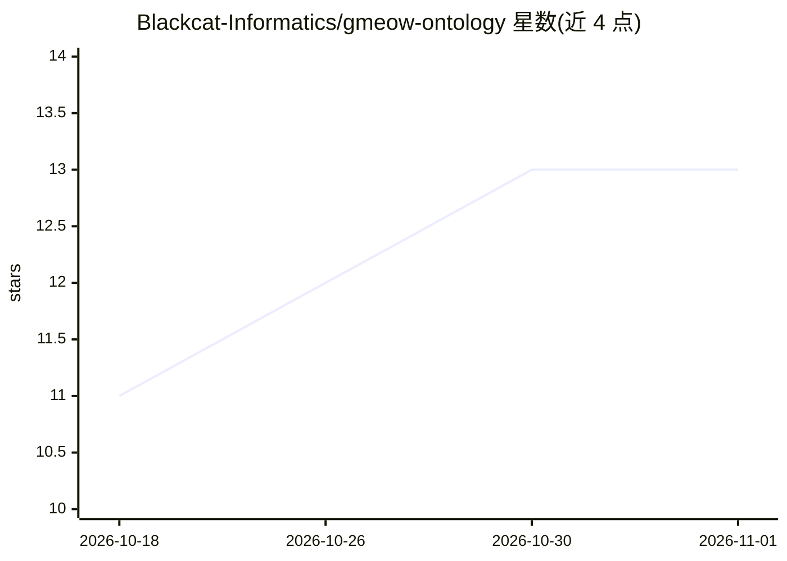

# Blackcat-Informatics/gmeow-ontology

⭐ 13 · Rust · AGPL-3.0 · 推送 2026-10-31 · [GitHub](https://github.com/Blackcat-Informatics/gmeow-ontology) · [官网](https://blackcatinformatics.ca/gmeow) · 组织维护

**面向 agent 记忆的溯源声明本体引擎：LLM 输出即声明而非事实**

GMEOW 是一个以 RDF 1.2 为底层的本体引擎与词汇表，把 LLM/RAG 输出、传感器读数与人类断言统一建模为带出处、置信度、时间范围的声明，支持立场索引的争议事实共存与'抑制不删除'的信念修订。旗舰用途是 grounded agent memory，通过 MCP server 提供 store_claim / recall / revise_belief 工具调用，并以 GTS 单文件 ai-package 形式提供跨会话可移植记忆。对 OWL、SHACL、JSON-LD、schema.org 等做有损投影，对 gUFO、BFO 等 85 个外部词汇表做对齐。本体 CC BY 4.0、工具链 AGPL-3.0 双许可，由 Blackcat Informatics 公司维护。

## 筛选速览

| 维度 | 判定 | 备注 |
|---|---|---|
| AI 角色 | `ai-ecosystem` | LLM/agent 周边工具 |
| 许可风险 | `dual` | AGPL-3.0 |
| 部署形态 | `library` | 以包/库形式分发 |
| 模型依赖 | — | README 未给出锁定关系 |
| 硬件要求 | — | 无带数字的原话,不猜 |
| 安装摩擦 | `medium` | 含编译或系统依赖之一 |
| 成熟度 | — | 结构信号不足 |

## 能力要点

- 统一 claim 构造：LLM 输出、传感器读数、人类断言为同一 reified 结构，带出处与置信度
- MCP server 提供 store_claim / recall / revise_belief 三件套与本体工具链
- 信念修订为抑制而非删除，保留完整审计轨迹
- 投影到 OWL/SHACL/JSON-LD 等 15+ 词汇表，对齐 85 个外部词汇表

## 适用场景

- 为 LLM agent 建立可区分回忆与虚构的落地记忆存储
- 记录两个模型对同一事实的分歧并保留双方立场
- 把知识图谱事实连同出处、置信度、时间范围发布到 linked-data 生态

## 场景标签

`Agent 记忆` `知识图谱` · 领域:Agent 开发

## 证据(README 行号)

> L17: whether it has since been defeated.** Its flagship use is **grounded agent memory** — store
> L54: |**Grounded-memory MCP server**|`store_claim` / `recall` / `revise_belief` tool-calls for agents, backed by the cla
> L81: **Why does this exist?** Because LLM and RAG outputs are stored as *truth* — no provenance,

## 星数曲线

2026-10-18 11 → 2026-11-01 13（+2）

---
*卡片 v1 · prompt 1.4 · 生成 2026-10-31 · 置信度 mid · 依据 README sha `a22162cc08d4` · [字段定义](../../DATASET.md)*
