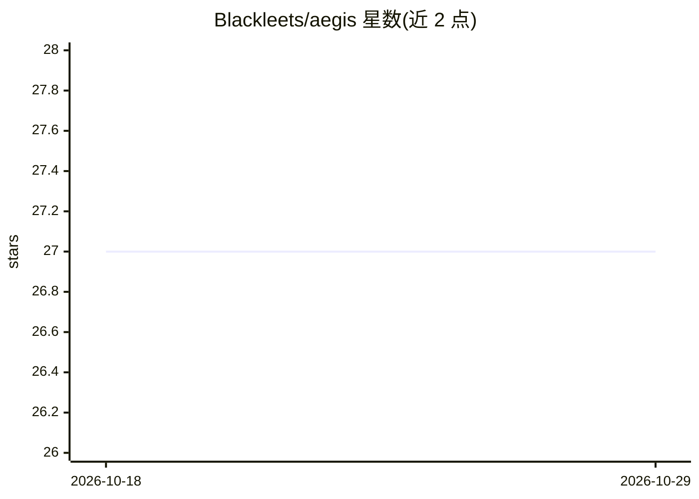

# Blackleets/aegis

⭐ 27 · TypeScript · MIT · 推送 2026-09-28 · [GitHub](https://github.com/Blackleets/aegis) · [官网](https://aegis-sage-eight.vercel.app) · 个人维护

**自托管 OSINT 态势感知平台：实时地图层+侦察工具+AI 简报**

基于 Next.js/React/TypeScript/MapLibre 的指挥中心式 Web 应用，面向操作人员提供实时全球跟踪图层（航班、卫星、火灾、气象、海事、CCTV 等）、浏览器端 RECON 侦察工具集（DNS、WHOIS、SSL、CVE、IP 扫描等）以及接入 Gemini API 的 AI 分析师面板与融合档案生成（BLUF、置信度、风险框架、监视清单）。多数数据层来自无 key 公共源；RECON 功能需独立 scanner 后端；支持 Docker Compose 自托管。

## 筛选速览

| 维度 | 判定 | 备注 |
|---|---|---|
| AI 角色 | `ai-enhanced` | 去掉 AI 部分产品仍成立 |
| 许可风险 | `permissive` | MIT |
| 部署形态 | `self-host` | docker 或自建部署 |
| 模型依赖 | — | README 未给出锁定关系 |
| 硬件要求 | — | 无带数字的原话,不猜 |
| 安装摩擦 | `low` | 无编译、无系统依赖或容器化 |
| 成熟度 | — | 结构信号不足 |

## 能力要点

- 实时全球地图多源图层（航班/卫星/火灾/气象/海事/CCTV/基础设施）
- RECON 工具集：DNS、WHOIS、SSL、headers、CVE、威胁、电话、MAC、GitHub、IP 扫描
- AI 分析师面板与融合档案生成（BLUF/置信度/风险/热点/行动/监视清单）
- 多数数据层使用无 key 公共源，支持 Docker Compose 自托管

## 适用场景

- 安全或地缘情报团队搭建可定制的自托管情报仪表盘
- 对目标做浏览器端 OSINT 侦察并生成融合档案
- 在实时数据流之上获取 AI 辅助摘要与区域简报

## 场景标签

`网络安全` · 领域:学习与行业

## 证据(README 行号)

> L11: AEGIS turns public telemetry into an operator-ready monitoring workspace with live map layers, browser-based recon 
> L25: - Live global map with flights, satellites, fires, weather, maritime, CCTV, infrastructure, and incident overlays
> L27: - AI analyst panel for operational questioning and synthesis

## 星数曲线

2026-10-18 27 → 2026-10-29 27（+0）

---
*卡片 v1 · prompt 1.4 · 生成 2026-10-26 · 置信度 high · 依据 README sha `a7caf2724f66` · [字段定义](../../DATASET.md)*
