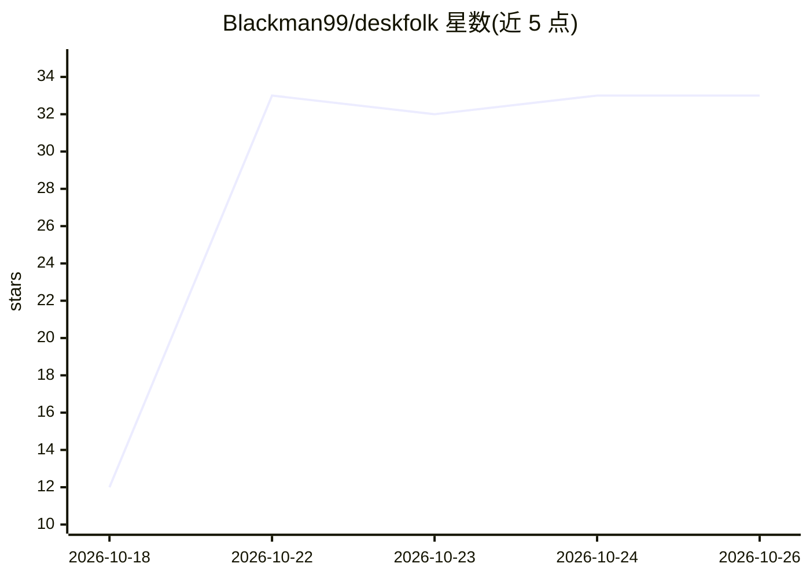

# Blackman99/deskfolk

⭐ 33 · TypeScript · MIT · 推送 2026-10-25 · [GitHub](https://github.com/Blackman99/deskfolk) · [官网](https://blackman99.github.io/deskfolk/) · 个人维护 · 中文 README

**本地优先的桌面多智能体委托应用：交活、走人、回来看结果**

运行在 macOS（Windows 预览版）的桌面应用，把多日多步任务以工单形式交给多个 Bot（Producer 负责拆票分派，制作者与审阅者分工），支持在应用内播放、阅读、批注产出文件；Bot 声称完成时应用先执行检查与评审再交付。无需 API key：可复用本机已登录的 Claude Code、Codex、Grok 等编码 agent 或任意 ACP agent，也可连接 OpenAI、Anthropic、DeepSeek、Qwen、Ollama、LM Studio 等模型源。带权限模式、可随时叫停、复盘改进与手机端查看。Rust + SvelteKit 构建，MIT 许可。

## 筛选速览

| 维度 | 判定 | 备注 |
|---|---|---|
| AI 角色 | `ai-ecosystem` | LLM/agent 周边工具 |
| 许可风险 | `permissive` | MIT |
| 部署形态 | `None` |  |
| 模型依赖 | local-ok | 支持本地模型 |
| 硬件要求 | — | 无带数字的原话,不猜 |
| 安装摩擦 | `low` | 无编译、无系统依赖或容器化 |
| 成熟度 | `idea` | |

## 能力要点

- 以工单（ticket）组织多日多步任务，制作者/审阅者分工
- 复用本机已登录的编码 agent（Claude Code/Codex/Grok 等）或任意 ACP agent，无需 API key
- 完成需通过检查、评审与用户确认；支持权限模式与随时叫停
- 产出的文件（含影片）在应用内播放、阅读与批注

## 适用场景

- 把多天多步骤的作业委托给本地 agent，人离开后由应用监督执行
- 通过手机查看对话、结果与任务检查情况
- 让多个本地已登录的编码 agent 分工协作完成一项工作

## 场景标签

`多智能体` `AI 助手` · 领域:Agent 开发

## 证据(README 行号)

> L11:  Files are kept by job and ticket, and played, read and annotated right in the app; every turn is on the flow, with
> L13:  No API key needed: pick the Claude Code, Codex, Grok, OpenCode, Antigravity or ZCode you have signed in on this co

## 星数曲线

2026-10-18 12 → 2026-10-26 33（+21）

---
*卡片 v1 · prompt 1.4 · 生成 2026-10-26 · 置信度 high · 依据 README sha `092eb98b9c67` · [字段定义](../../DATASET.md)*
