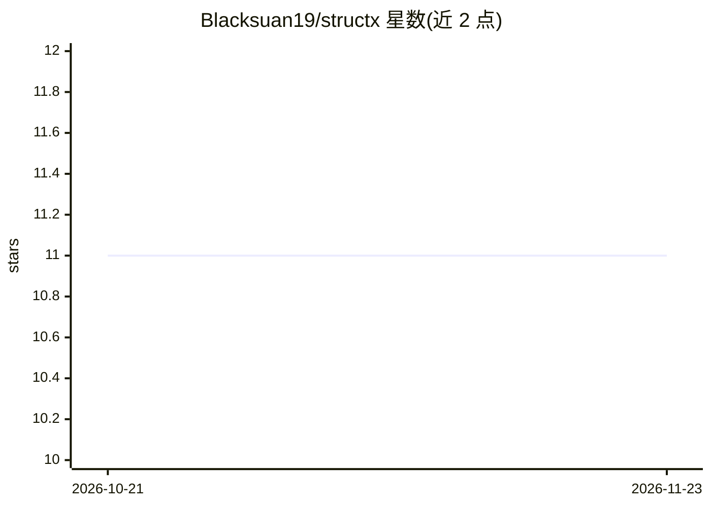

# Blacksuan19/structx

⭐ 11 · Python · MIT · 推送 2026-09-22 · [GitHub](https://github.com/Blacksuan19/structx) · [官网](https://structx.aolabs.dev) · 个人维护

**开发者用 LLM 从文本与文档中提取类型安全的结构化数据**

Python 库，通过 LLM 从文本、表格与文档中提取结构化数据：从自然语言查询生成 Pydantic 类型安全模型并自动推断 schema，支持嵌套结构。PDF 直接走视觉多模态通道，DOCX/PPTX 等格式经可选 docs extra（Docling 解析 + WeasyPrint 转换）转 PDF 处理；CSV/Excel/JSON/Parquet 等结构化数据直接处理。内置指数退避重试、线程化同步与原生异步请求、逐步 token 用量统计，配置支持参数/YAML/环境变量。模型接入通过 litellm 集成实现。

## 筛选速览

| 维度 | 判定 | 备注 |
|---|---|---|
| AI 角色 | `ai-native` | 本体是模型或模型工具 |
| 许可风险 | `permissive` | MIT |
| 部署形态 | `library` | 以包/库形式分发 |
| 模型依赖 | — | README 未给出锁定关系 |
| 硬件要求 | — | 无带数字的原话,不猜 |
| 安装摩擦 | `low` | 无编译、无系统依赖或容器化 |
| 成熟度 | — | 结构信号不足 |

## 能力要点

- 从自然语言查询生成类型安全的 Pydantic 模型并自动推断 schema
- PDF 直传视觉模型的多模态提取管道，非 PDF 格式经 Docling+WeasyPrint 转换
- 通过 litellm 集成接入多家 LLM 提供商
- token 用量分步统计、指数退避重试、同步与异步处理

## 适用场景

- 从 PDF 发票、报告中提取结构化字段
- 对 CSV/Excel 等结构化数据按自然语言描述抽取信息
- 在提取前估算 PDF 页数与文本量

## 场景标签

`文档解析` · 领域:知识与检索

## 证据(README 行号)

> L13: `structx` is a powerful Python library for extracting structured data from text,
> L68: - **🔌 Multiple LLM Providers**: Support through litellm integration
> L201: - **PDF passthrough**: Existing PDFs are sent directly to multimodal extraction

## 星数曲线

2026-10-21 11 → 2026-11-23 11（+0）

---
*卡片 v1 · prompt 1.4 · 生成 2026-11-19 · 置信度 high · 依据 README sha `fd81716831d1` · [字段定义](../../DATASET.md)*
