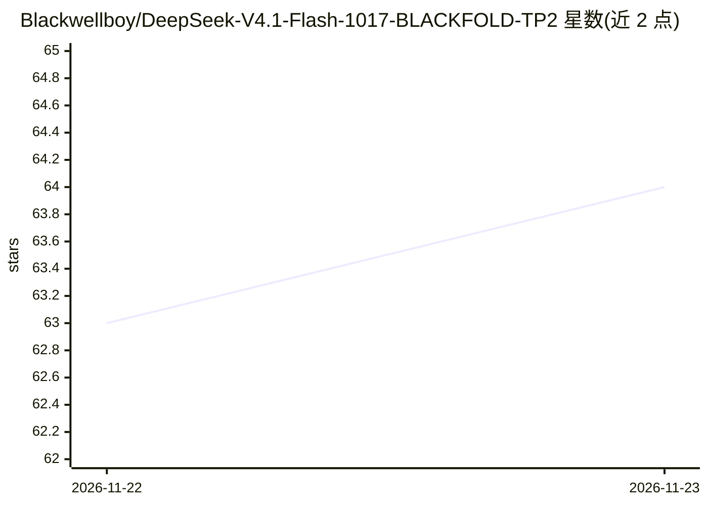

# Blackwellboy/DeepSeek-V4.1-Flash-1017-BLACKFOLD-TP2

⭐ 64 · Python · Apache-2.0 · 推送 2026-11-21 · [GitHub](https://github.com/Blackwellboy/DeepSeek-V4.1-Flash-1017-BLACKFOLD-TP2) · [官网](https://huggingface.co/BlackwellBoy/DeepSeek-V4.1-Flash-1017-BLACKFOLD-EXL3-2.9bpw-TP2) · 个人维护

**在双 DGX Spark 上运行 DeepSeek-V4.1-Flash 的 TP2 部署配方**

面向持有两台 GB10（DGX Spark，128 GB）节点的用户，提供在 200 GbE 互连上以 TensorFold 原生引擎跑 DeepSeek-V4.1-Flash-1017（763B MoE）EXL3 量化权重的完整流程：双节点权重准备、引擎构建（含 3 个补丁）、RoCE 双轨网络配置、启动脚本与全部基准测量数据。输出 OpenAI 兼容 API（端口 18191，1M 上下文、工具调用、视觉、thinking 开关）。内容含已踩坑清单与修复说明，脚本与文档为 Apache-2.0，权重经 gated HF 仓库分发。

## 筛选速览

| 维度 | 判定 | 备注 |
|---|---|---|
| AI 角色 | `ai-native` | 本体是模型或模型工具 |
| 许可风险 | `permissive` | Apache-2.0 |
| 部署形态 | `None` |  |
| 模型依赖 | — | README 未给出锁定关系 |
| 硬件要求 | — | 无带数字的原话,不猜 |
| 安装摩擦 | `low` | 无编译、无系统依赖或容器化 |
| 成熟度 | — | 结构信号不足 |

## 能力要点

- 提供 3 个 TensorFold 引擎补丁及逐项修因说明
- 双轨 RoCE 网络配置与预检/测速工具（bf_preflight.sh、bf_lab.py）
- OpenAI 兼容 API：1M 上下文、4 并行流、视觉与工具调用
- 发布完整基准结果与 token 级一致性 A/B 测量数据

## 适用场景

- 在两台 DGX Spark 上本地部署 DeepSeek 大模型并对外提供 OpenAI 兼容 API
- 复现并核对该配置下的 prefill/decode 吞吐与拒答率数据
- 为 TP2 张量并行部署排查工具调用泄漏、缓存失效等引擎问题

## 场景标签

 · 领域:LLM 本地部署/推理基础设施

## 证据(README 行号)

> L5: **Uncensored, fast, and checked.** DeepSeek-V4.1-Flash-1017 (763B MoE) on two DGX Sparks: JailbreakBench
> L13: This is the TP2 recipe: how to run BLACKFOLD on two GB10 nodes with TensorFold's native engine, the three engine
> L62: OpenAI-compatible API on port 18191: 1M context, 4 parallel streams, vision, tool calls, thinking on by default

## 星数曲线

2026-11-22 63 → 2026-11-23 64（+1）

---
*卡片 v1 · prompt 1.4 · 生成 2026-11-22 · 置信度 high · 依据 README sha `f64786c3fcde` · [字段定义](../../DATASET.md)*
