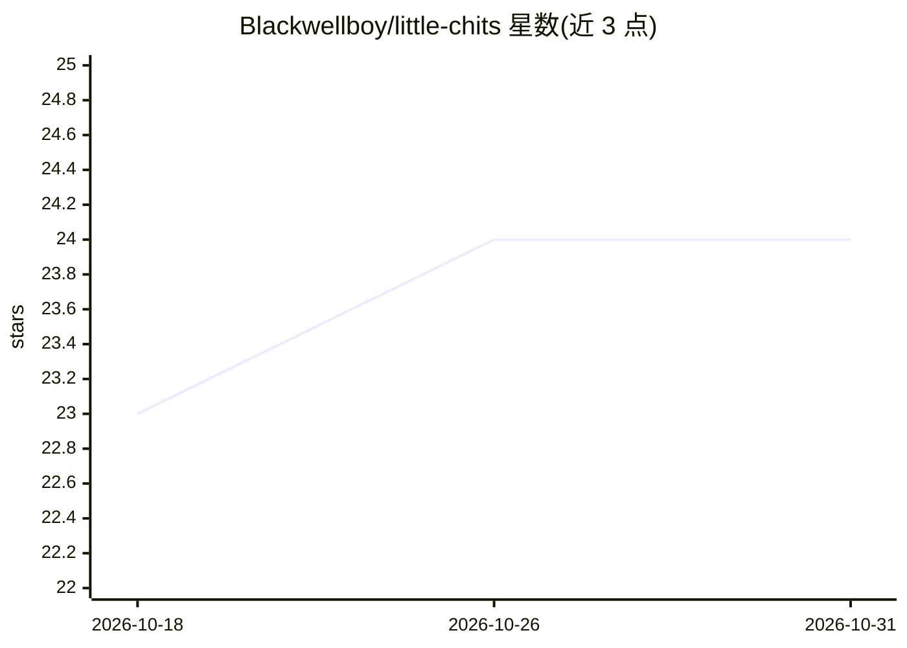

# Blackwellboy/little-chits

⭐ 24 · Python · MIT · 推送 2026-10-17 · [GitHub](https://github.com/Blackwellboy/little-chits) · 个人维护

**可接入任意 LLM 驱动小生物的人工生命文明模拟**

浏览器中观看的岛屿文明模拟：小生物（chits）从近乎无知开始，通过实验发现配方、建造建筑、互相传授知识、繁衍衰老。可接入本地 llama.cpp/vLLM/Ollama/LM Studio 或云 API 作为其‘心智’，支持同种子双世界的模型对比（model vs model）与禁用语言的文化实验；无模型时以内置本能规划器运行。提供 git clone+make、Docker Compose 与 WSL 桌面快捷方式三种运行方式，自动扫描本机模型服务器。

## 筛选速览

| 维度 | 判定 | 备注 |
|---|---|---|
| AI 角色 | `ai-native` | 本体是模型或模型工具 |
| 许可风险 | `permissive` | MIT |
| 部署形态 | `self-host` | docker 或自建部署 |
| 模型依赖 | local-ok | 支持本地模型 |
| 硬件要求 | — | 无带数字的原话,不猜 |
| 安装摩擦 | `low` | 无编译、无系统依赖或容器化 |
| 成熟度 | — | 结构信号不足 |

## 能力要点

- 任意 OpenAI 兼容 LLM 作为 chits 心智，可双世界对比不同模型
- 同种子双世界实验：直接文化 vs 仅痕迹传递（stigmergy）
- 四类学习机制：带溯源的知识、情景记忆、每周反思教训、练习成技能
- 自动录制模式：逐日生成 timelapse 视频与当日故事 Markdown

## 适用场景

- 观看 LLM 驱动的小文明从石器发展到文字与纪念碑
- 在相同岛屿上让两个模型对比谁发展得更快
- 做禁止语言交流的文化传播对照实验
- 为社交媒体生成文明发展过程的短视频素材

## 场景标签

 · 领域:模拟/游戏

## 证据(README 行号)

> L8: You can plug **any LLM** into their minds. A local GGUF on llama.cpp, vLLM on your GPUs, Ollama, LM Studio, or
> L22: That's it. The first time it runs, it looks for model servers on this computer (llama-server, Ollama,
> L101: On first start it **scans your machine for model servers** (llama.cpp, vLLM, Ollama, LM Studio…). If it finds

## 星数曲线

2026-10-18 23 → 2026-10-31 24（+1）

---
*卡片 v1 · prompt 1.4 · 生成 2026-10-27 · 置信度 mid · 依据 README sha `6686564127d6` · [字段定义](../../DATASET.md)*
