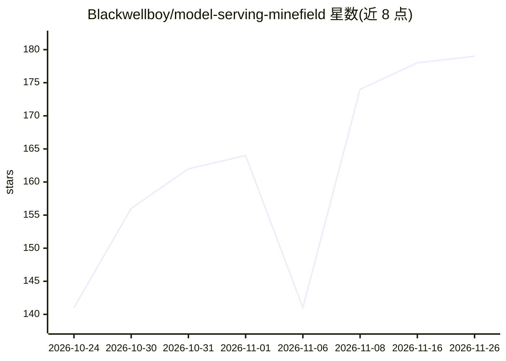

# Blackwellboy/model-serving-minefield

⭐ 179 · Python · MIT · 推送 2026-11-21 · [GitHub](https://github.com/Blackwellboy/model-serving-minefield) · 个人维护

**LLM 推理链路陷阱注册表与症状诊断 CLI，共 168 条**

收集 LLM 推理/评测链路上导致错误测量结果的陷阱（chat 模板、tool 解析、reasoning 字段、量化内核路径、CUDA 工具链、KV 分配、评测框架、版本漂移），每条按症状、机理、影响栈、检查方法与修复组织，并标注复现状态。提供 msmf CLI：症状匹配、对配置文件与端点的离线扫描、只读 doctor 检查（覆盖 70 条陷阱），以及供 agent 使用的 MCP server 与 llms.txt 路由文件。面向部署与评测 LLM 的工程师。

## 筛选速览

| 维度 | 判定 | 备注 |
|---|---|---|
| AI 角色 | `ai-ecosystem` | LLM/agent 周边工具 |
| 许可风险 | `permissive` | MIT |
| 部署形态 | `self-host` | docker 或自建部署 |
| 模型依赖 | local-ok | 支持本地模型 |
| 硬件要求 | — | 无带数字的原话,不猜 |
| 安装摩擦 | `low` | 无编译、无系统依赖或容器化 |
| 成熟度 | — | 结构信号不足 |

## 能力要点

- 168 条陷阱条目，每条带复现状态标签与可运行的检查
- minefield scan 可离线读取 docker-compose、启动脚本、config.json 与日志
- 只读 doctor 端点检查，覆盖 168 条中的 70 条并打印覆盖率
- 提供 MCP server 与 AGENT_START_HERE.md 供 AI agent 接入

## 适用场景

- 发现模型行为异常但请求与响应都看似正确时，按症状定位服务端陷阱
- 发布 A/B 基准结果前，用 playbook 清单核对推理与评测配置
- 让 agent 读取日志与配置，区分已确认与疑似的服务端问题
- 在不同推理栈（vLLM/llama.cpp/Ollama 等）之间移植评测框架前做预检

## 场景标签

`模型评测` · 领域:评测与运维

## 证据(README 行号)

> L11: Every entry here produced a **confidently wrong measurement** on a real
> L61: 131 of the 168 traps have at least one automatic check
> L121: **MCP user:** run `minefield-mcp` over stdio. It exposes search,

## 星数曲线

2026-10-24 141 → 2026-11-26 179（+38）

---
*卡片 v1 · prompt 1.4 · 生成 2026-11-26 · 置信度 mid · 依据 README sha `8a0a03c781b4` · [字段定义](../../DATASET.md)*
