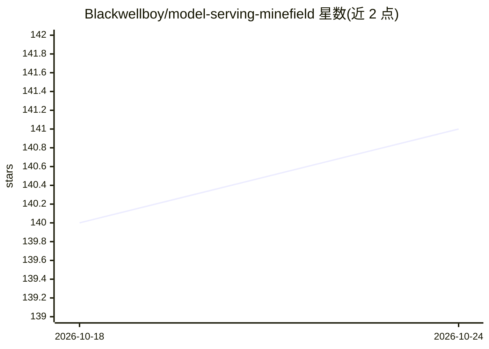

# Blackwellboy/model-serving-minefield

⭐ 141 · Python · MIT · 推送 2026-10-23 · [GitHub](https://github.com/Blackwellboy/model-serving-minefield) · 组织维护

**LLM 服务路径陷阱登记库：166 条症状优先的度量错误诊断条目**

社区维护的 LLM serving 路径陷阱登记库，收录 166 条会在真实服务路径上产生“看起来对但数字错”的测量陷阱，覆盖 chat 模板、tool 解析器、reasoning 字段、量化 kernel 路径、容器工具链、KV 分配、评测框架与版本管理。每条按症状、机制、受影响栈、检查方法与修复组织，并带五级状态标签（如 reproduced here / reported by others）。另提供 msmf CLI：按症状匹配、离线扫描 compose/启动脚本/config.json/日志、对 live 端点做有界只读 doctor 检查（131/166 有自动检查），并有 MCP server 与 Hermes 插件入口。面向部署与评测 LLM 的工程师和研究员。

## 筛选速览

| 维度 | 判定 | 备注 |
|---|---|---|
| AI 角色 | `ai-knowledge` | 知识聚合/清单类 |
| 许可风险 | `permissive` | MIT |
| 部署形态 | `self-host` | docker 或自建部署 |
| 模型依赖 | local-ok | 支持本地模型 |
| 硬件要求 | — | 无带数字的原话,不猜 |
| 安装摩擦 | `low` | 无编译、无系统依赖或容器化 |
| 成熟度 | — | 结构信号不足 |

## 能力要点

- 166 条 canonical 陷阱条目，每条含症状、机制、检查与修复及五级状态标签
- msmf CLI 支持症状匹配、离线文件扫描与有界 live doctor 检查
- 131/166 条陷阱有至少一个自动检查
- 提供 MCP server（minefield-mcp）、Hermes 插件与 AI agent 诊断入口

## 适用场景

- 评测数字异常时按症状表定位 serving 层配置错误
- 上线前用 doctor 对 live 端点做 thinking-stack 预检
- 让 AI agent 借助该登记库诊断我的 serving 问题
- 迁移评测框架到新推理栈前查该栈最易踩的五个坑

## 场景标签

`LLM 可观测性` · 领域:评测与运维

## 证据(README 行号)

> L11: Every entry here produced a **confidently wrong measurement** on a real
> L13: kernel paths, container toolchains, memory allocation, eval harnesses,
> L175:  directly below, all 166 entries, one row each, sorted by number. It is the

## 星数曲线

2026-10-18 140 → 2026-10-24 141（+1）

---
*卡片 v1 · prompt 1.4 · 生成 2026-10-22 · 置信度 mid · 依据 README sha `d21ac285c385` · [字段定义](../../DATASET.md)*
