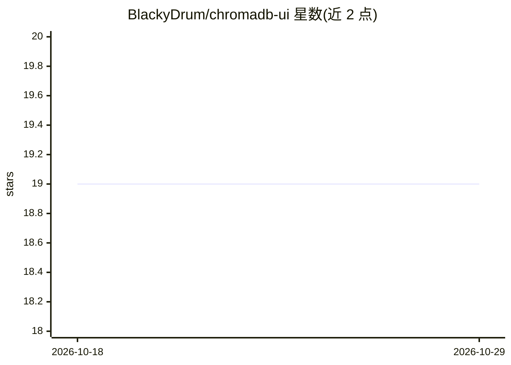

# BlackyDrum/chromadb-ui

⭐ 19 · Vue · MIT · 推送 2026-04-10 · [GitHub](https://github.com/BlackyDrum/chromadb-ui) · 个人维护

**ChromaDB 的 Web UI：可视化浏览、查询与编辑向量库数据**

面向 ChromaDB v2 API 的 Web 管理界面：通过 URL/tenant/database 连接 ChromaDB 服务器后，可浏览和管理集合（创建/重命名/克隆/删除）、编辑文档、元数据与嵌入向量、执行语义搜索与最近邻查询（可选 OpenAI 或 Ollama 作为嵌入提供方）、导入/更新 JSON 记录并自动生成缺失嵌入、批量操作与 CSV 导出，另含集合指标查看与活动日志。提供本地 Vite 开发流程、Docker Compose 与 GitHub Pages 部署页面三种使用方式。限制：仅支持 Chroma v2 API。

## 筛选速览

| 维度 | 判定 | 备注 |
|---|---|---|
| AI 角色 | `ai-ecosystem` | LLM/agent 周边工具 |
| 许可风险 | `permissive` | MIT |
| 部署形态 | `self-host` | docker 或自建部署 |
| 模型依赖 | local-ok | 支持本地模型 |
| 硬件要求 | — | 无带数字的原话,不猜 |
| 安装摩擦 | `low` | 无编译、无系统依赖或容器化 |
| 成熟度 | — | 结构信号不足 |

## 能力要点

- 集合浏览与创建/重命名/克隆/删除及元数据编辑
- 语义搜索与原始向量最近邻查询，嵌入提供方可选 OpenAI 或 Ollama
- 文档/元数据/嵌入向量的可视化编辑与批量操作（删除、元数据修补、CSV 导出）
- 集合指标查看（文档、元数据、嵌入统计与质量审计）

## 适用场景

- 不写代码直接浏览和检查 ChromaDB 中的数据
- 给记录补嵌入或手动粘贴向量并做语义搜索
- 对集合做批量清理、元数据修补和导出

## 场景标签

`向量数据库` · 领域:知识与检索

## 证据(README 行号)

> L3: ChromaDB UI is a web app for exploring and managing a ChromaDB instance through a visual interface instead of raw AP
> L27: - Choose an embedding provider for semantic queries, including OpenAI or Ollama.

## 星数曲线

2026-10-18 19 → 2026-10-29 19（+0）

---
*卡片 v1 · prompt 1.4 · 生成 2026-10-29 · 置信度 high · 依据 README sha `120b8377276c` · [字段定义](../../DATASET.md)*
