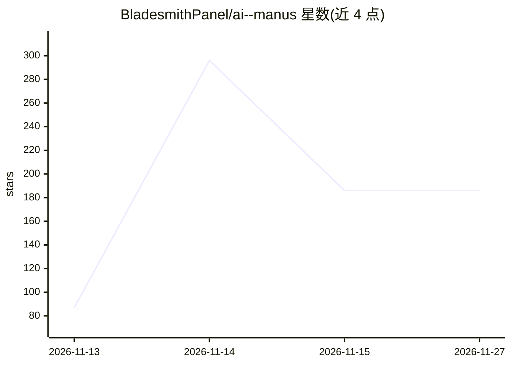

# BladesmithPanel/ai--manus

⭐ 186 · Apache-2.0 · 推送 2026-11-15 · [GitHub](https://github.com/BladesmithPanel/ai--manus) · 个人维护

**面向日常任务的自主 AI Agent：代用户执行代码与控制浏览器**

README 宣称 Manus 是一个自主 AI Agent，可在用户授权下编写并执行脚本、控制浏览器（导航网页、填写表单、收集信息）、执行多步骤任务，定位为家庭、学习与轻量办公场景的后台个人助手，而非企业级平台。机制层面仅描述代码执行与浏览器控制两条主线及跨会话的任务模式记忆。README 未提供任何安装命令、技术架构、模型接入方式或代码仓库实体说明，仅在末尾附下载名与促销码，信息以功能描述为主，可验证的技术细节有限。

## 筛选速览

| 维度 | 判定 | 备注 |
|---|---|---|
| AI 角色 | `ai-native` | 本体是模型或模型工具 |
| 许可风险 | `permissive` | Apache-2.0 |
| 部署形态 | `None` |  |
| 模型依赖 | — | README 未给出锁定关系 |
| 硬件要求 | — | 无带数字的原话,不猜 |
| 安装摩擦 | `low` | 无编译、无系统依赖或容器化 |
| 成熟度 | — | 结构信号不足 |

## 能力要点

- 自主代码执行：agent 自行编写并运行脚本完成任务
- 浏览器控制：导航网页、填写表单、收集信息
- 代码与浏览器动作可在同一任务流中衔接
- 定位家庭/学习/轻量办公的小规模任务场景

## 适用场景

- 让 agent 代为整理研究资料、跑小脚本
- 自动检查网页更新或填写重复表单
- 在远程工作中从多个页面收集数据

## 场景标签

`AI 助手` `浏览器自动化` `编码 Agent` · 领域:效率与自动化

## 证据(README 行号)

> L10: - **Autonomous Code Execution:** Manus AI agent runs code on its own to complete tasks, so you can focus on decisio
> L18: Manus is an autonomous AI agent designed to run code and control a browser on your behalf. Instead of acting like a

## 星数曲线

2026-11-13 87 → 2026-11-27 186（+99）

---
*卡片 v1 · prompt 1.4 · 生成 2026-11-17 · 置信度 low · 依据 README sha `0f78ee3a5dd2` · [字段定义](../../DATASET.md)*
