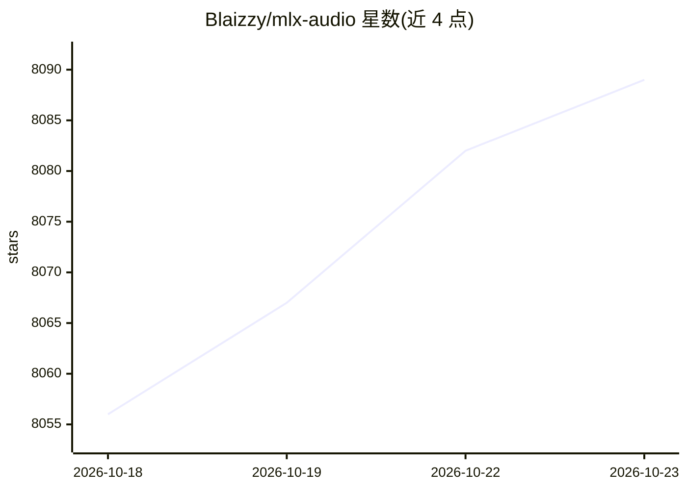

# Blaizzy/mlx-audio

⭐ 8,089 · Python · MIT · 推送 2026-10-22 · [GitHub](https://github.com/Blaizzy/mlx-audio) · [官网](https://blaizzy.github.io/mlx-audio/) · 个人维护

**Apple Silicon 上的 TTS/STT/STS 语音处理库，服务开发者**

基于 Apple MLX 框架的 Python 语音库，覆盖文本转语音、语音转文本、语音到语音、说话人分离、语音增强与音乐生成，聚合 Kokoro、Whisper、Qwen3-TTS 等数十种模型，量化支持 3-8bit。提供命令行工具、Python API、带 3D 音频可视化的 Web 界面、OpenAI 兼容 REST API 及 Swift 包（iOS/macOS）。仅适用于 Apple Silicon（M 系列芯片）；部分模型（如 Kokoro）需另装 misaki 等依赖。

## 筛选速览

| 维度 | 判定 | 备注 |
|---|---|---|
| AI 角色 | `ai-native` | 本体是模型或模型工具 |
| 许可风险 | `permissive` | MIT |
| 部署形态 | `library` | 以包/库形式分发 |
| 模型依赖 | — | README 未给出锁定关系 |
| 硬件要求 | — | 无带数字的原话,不猜 |
| 安装摩擦 | `medium` | 含编译或系统依赖之一 |
| 成熟度 | — | 结构信号不足 |

## 能力要点

- TTS/STT/STS/VAD/语音增强/音乐生成多类模型聚合
- 3/4/6/8bit 量化支持与流式生成
- OpenAI 兼容 REST API 与交互式 Web 界面
- 提供 iOS/macOS Swift 包

## 适用场景

- 在 Mac 上本地运行 TTS 与 ASR 模型
- 通过 CLI 或 Python API 批量生成/转录音频
- 构建 OpenAI 兼容的本地语音服务

## 场景标签

`语音合成` `语音识别` · 领域:内容生成

## 证据(README 行号)

> L10: The best audio processing library built on Apple's MLX framework, providing fast and efficient text-to-speech (TTS)
> L108: |**Whisper**|OpenAI's robust STT model|99+ languages|mlx-community/whisper-large-v3-turbo-asr-fp16|

## 星数曲线

2026-10-18 8,056 → 2026-10-23 8,089（+33）

---
*卡片 v1 · prompt 1.4 · 生成 2026-10-20 · 置信度 mid · 依据 README sha `35baf8bb2c15` · [字段定义](../../DATASET.md)*
