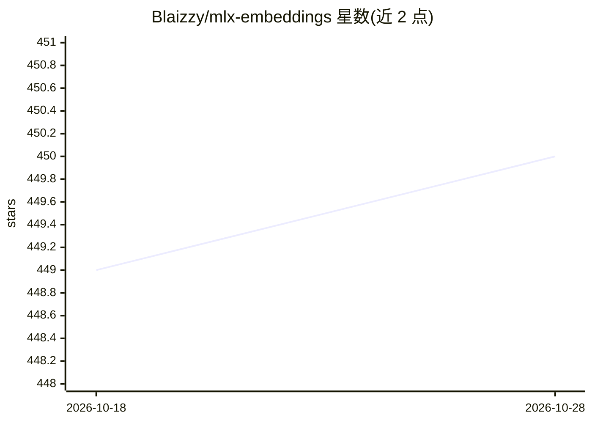

# Blaizzy/mlx-embeddings

⭐ 452 · Python · NOASSERTION · 推送 2026-05-13 · [GitHub](https://github.com/Blaizzy/mlx-embeddings) · 个人维护

**在 Mac 上用 MLX 本地运行视觉与语言嵌入模型的 Python 包**

基于 Apple MLX 框架的 Python 包，为文本与图像生成嵌入向量，供检索/RAG 等场景在 Mac 上本地运行。支持 XLM-RoBERTa、BERT、ModernBERT、Qwen3/Qwen3-VL、Llama 双向、Nemotron VL、privacy-filter 等架构，覆盖多模态嵌入与重排、掩码语言建模、序列分类与 PII 令牌分类。附带 Hugging Face 模型到 MLX 格式的转换工具，支持 affine/mxfp4/nvfp4/mxfp8 量化模式。限定 macOS + MLX 环境。

## 筛选速览

| 维度 | 判定 | 备注 |
|---|---|---|
| AI 角色 | `ai-native` | 本体是模型或模型工具 |
| 许可风险 | `none` | NOASSERTION |
| 部署形态 | `library` | 以包/库形式分发 |
| 模型依赖 | — | README 未给出锁定关系 |
| 硬件要求 | — | 无带数字的原话,不猜 |
| 安装摩擦 | `low` | 无编译、无系统依赖或容器化 |
| 成熟度 | — | 结构信号不足 |

## 能力要点

- 文本与图像嵌入生成，支持单项与批处理
- 多模态嵌入与重排（Qwen3-VL、ColPali/ColQwen）
- PII 令牌分类（openai/privacy-filter，8 类 BIOES 标注）
- HF→MLX 转换工具与 4 种量化模式（affine/mxfp4/nvfp4/mxfp8）

## 适用场景

- 在 Mac 上本地生成文本/图像嵌入用于检索或 RAG
- 将 Hugging Face 嵌入模型转换为 MLX 格式并量化
- 图像-文本匹配与多模态重排
- 检测文本中的个人身份信息（PII）

## 场景标签

`语义搜索` `模型量化` · 领域:知识与检索

## 证据(README 行号)

> L5: **MLX-Embeddings is a package for running Vision and Language Embedding models locally on your Mac using MLX.**
> L11: - Generate embeddings for text and images using MLX models

## 星数曲线

2026-10-18 449 → 2026-10-28 450（+1）

---
*卡片 v1 · prompt 1.4 · 生成 2026-10-21 · 置信度 high · 依据 README sha `5b0845825492` · [字段定义](../../DATASET.md)*
