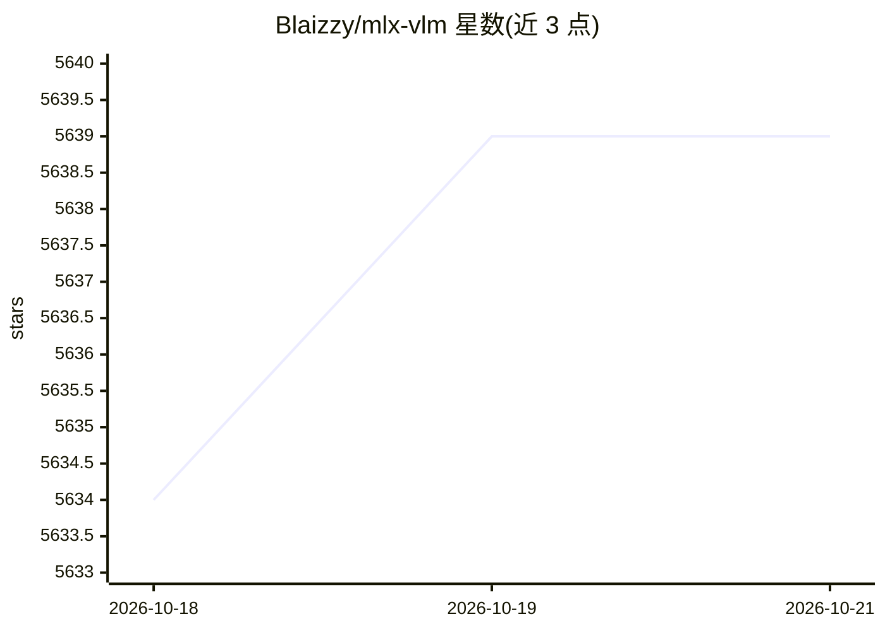

# Blaizzy/mlx-vlm

⭐ 5,639 · Python · MIT · 推送 2026-10-19 · [GitHub](https://github.com/Blaizzy/mlx-vlm) · 个人维护

**Mac 上基于 MLX 的视觉语言模型推理与微调包**

面向 Apple Silicon Mac 用户（依赖 MLX 框架）的视觉语言模型（VLM）及支持音视频的全模态模型工具包：提供 CLI（生成、转换量化）、本地 server、Gradio 聊天界面与 Python API，覆盖 40+ 模型架构的专属文档；支持思考模式预算控制、投机解码（DFlash/EAGLE-3/MTP 多种 drafter，实测最高 3.94× 提速）与模型量化转换（RTN/AWQ）。另附带可装载到编码 agent 的技能包。以 pip 安装的 Python 包形式分发，UI 需额外 extra。

## 筛选速览

| 维度 | 判定 | 备注 |
|---|---|---|
| AI 角色 | `ai-ecosystem` | LLM/agent 周边工具 |
| 许可风险 | `permissive` | MIT |
| 部署形态 | `library` | 以包/库形式分发 |
| 模型依赖 | — | README 未给出锁定关系 |
| 硬件要求 | — | 无带数字的原话,不猜 |
| 安装摩擦 | `medium` | 含编译或系统依赖之一 |
| 成熟度 | — | 结构信号不足 |

## 能力要点

- CLI、本地 server、Gradio UI 与 Python API 四种使用方式
- 40+ VLM 架构专属文档（Qwen-VL、Gemma 4、MiniCPM、DeepSeek-OCR 等）
- 投机解码：DFlash/DFlash2/DSpark、EAGLE-3、MTP 多种 drafter 家族
- Hugging Face 模型转换与量化（RTN/AWQ、混合量化配方）

## 适用场景

- 在 Mac 本地运行和对话视觉语言模型
- 把 Hugging Face 模型转换量化为 MLX 格式
- 通过本地 server 或 Python API 将 VLM 接入自己的应用

## 场景标签

`多模态` `微调` `模型量化` `推理引擎` · 领域:感知与多模态

## 证据(README 行号)

> L4: MLX-VLM is a package for inference and fine-tuning of Vision Language Models (VLMs) and Omni Models (VLMs with audio
> L50: The easiest way to get started is to install the `mlx-vlm` package using pip:
> L312: ### Chat UI with Gradio

## 星数曲线

2026-10-18 5,634 → 2026-10-21 5,639（+5）

---
*卡片 v1 · prompt 1.4 · 生成 2026-10-20 · 置信度 high · 依据 README sha `28a6051d589d` · [字段定义](../../DATASET.md)*
