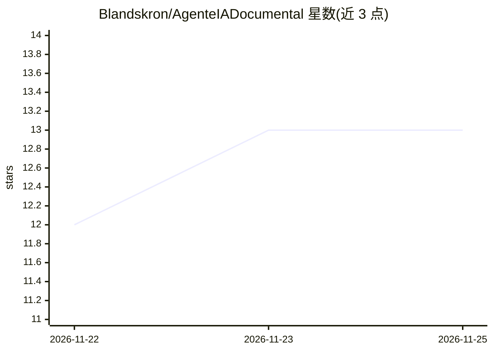

# Blandskron/AgenteIADocumental

⭐ 13 · Python · MIT · 推送 2026-11-23 · [GitHub](https://github.com/Blandskron/AgenteIADocumental) · [官网](https://blandskron.github.io/AgenteIADocumental/) · 组织维护

**面向文档管理与问答的开源 RAG 平台**

开源文档管理与查询应用：支持上传与组织文档、按内容检索、以引用来源的形式回答提问，界面可查看召回片段、保存会话并导出回答为 PDF。架构为 React/TypeScript 前端加 Django 身份管理与十一个微服务；文档摄取与聊天在 CPU 上本地计算 E5 embeddings，PostgreSQL/pgvector 存储向量，按权限将问题与上下文发送给 Groq 生成回答。需 Git 与 Docker Compose 部署，Google Drive 集成为可选且默认关闭。

## 筛选速览

| 维度 | 判定 | 备注 |
|---|---|---|
| AI 角色 | `ai-native` | 本体是模型或模型工具 |
| 许可风险 | `permissive` | MIT |
| 部署形态 | `self-host` | docker 或自建部署 |
| 模型依赖 | — | README 未给出锁定关系 |
| 硬件要求 | — | 无带数字的原话,不猜 |
| 安装摩擦 | `low` | 无编译、无系统依赖或容器化 |
| 成熟度 | — | 结构信号不足 |

## 能力要点

- 本地计算 embeddings（multilingual-e5-small，构建时下载约 471 MB 模型）
- PostgreSQL/pgvector 语义检索，回答附带来源引用
- 十一个微服务与 Django 身份管理、访问控制
- Google Drive 集成与回答导出 PDF（可选/默认关闭 Drive）

## 适用场景

- 搭建带来源引用的文档知识库问答
- 团队内部按权限检索与查阅文档
- 将问答结果导出 PDF 归档

## 场景标签

`文档问答` `RAG` · 领域:知识与检索

## 证据(README 行号)

> L3: Aplicación de código abierto para la gestión y consulta documental, desarrollada por Blandskron. Permite cargar y or
> L5: La web usa React y TypeScript. Django administra la identidad y once servicios de aplicación en total cubren el reco

## 星数曲线

2026-11-22 12 → 2026-11-25 13（+1）

---
*卡片 v1 · prompt 1.4 · 生成 2026-11-22 · 置信度 high · 依据 README sha `dd5f5367f2a8` · [字段定义](../../DATASET.md)*
