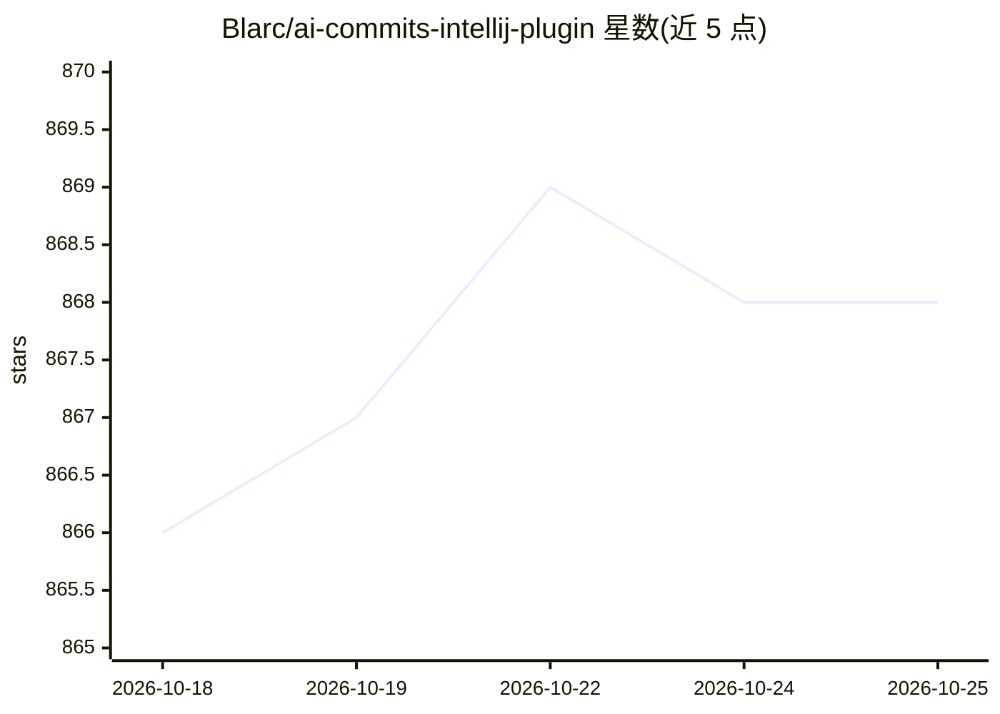

# Blarc/ai-commits-intellij-plugin

⭐ 868 · Kotlin · MIT · 推送 2026-10-21 · [GitHub](https://github.com/Blarc/ai-commits-intellij-plugin) · [官网](https://plugins.jetbrains.com/plugin/21335-ai-commits) · 个人维护

**JetBrains IDE 插件：用 LLM 从 git diff 生成提交信息**

面向 IntelliJ 系 IDE 与 Android Studio 的插件：读取 git diff（可限定选中的文件与行），调用用户在设置中配置的 LLM API 客户端生成 commit message，支持自定义 prompt、预定义变量与提示词，兼容 Git 与 Subversion。模型接入基于 langchain4j 实现，列出的支持列表包括 Amazon Bedrock、Anthropic、Azure OpenAI、Gemini、Ollama、千帆（文心）等。通过 JetBrains Marketplace 或 zip 导入安装。

## 筛选速览

| 维度 | 判定 | 备注 |
|---|---|---|
| AI 角色 | `ai-enhanced` | 去掉 AI 部分产品仍成立 |
| 许可风险 | `permissive` | MIT |
| 部署形态 | `None` |  |
| 模型依赖 | local-ok | 支持本地模型 |
| 硬件要求 | — | 无带数字的原话,不猜 |
| 安装摩擦 | `low` | 无编译、无系统依赖或容器化 |
| 成熟度 | — | 结构信号不足 |

## 能力要点

- 从 git diff 用 LLM 生成提交信息，可限定选中文件与行
- 自定义 prompt、预定义变量与提示词
- 基于 langchain4j 实现通用 LLM 客户端，支持十余种模型来源
- 支持 Git 与 Subversion 两种版本控制系统

## 适用场景

- 写提交信息时让 AI 根据 diff 自动生成内容
- 在 JetBrains 全家桶或 Android Studio 内一体化完成提交信息撰写
- 按团队规范自定义生成 prompt

## 场景标签

`代码生成` · 领域:编码与开发

## 证据(README 行号)

> L14: AI Commits is a plugin that generates your commit messages by using git diff and LLMs. To get started, install the
> L49: IntelliJ IDEA, PhpStorm, WebStorm, PyCharm, RubyMine, AppCode, CLion, GoLand, DataGrip, Rider, MPS, Android Studio,

## 星数曲线

2026-10-18 866 → 2026-10-25 868（+2）

---
*卡片 v1 · prompt 1.4 · 生成 2026-10-21 · 置信度 high · 依据 README sha `90f9b546861a` · [字段定义](../../DATASET.md)*
