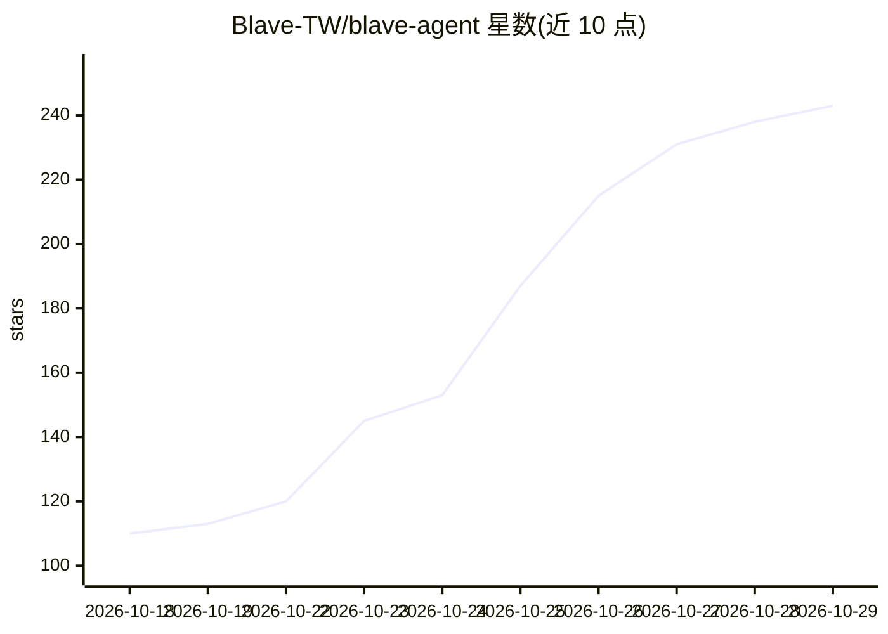

# Blave-TW/blave-agent

⭐ 243 · Python · Apache-2.0 · 推送 2026-10-28 · [GitHub](https://github.com/Blave-TW/blave-agent) · [官网](https://blave.org) · 组织维护 · 中文 README

**让 Claude Code/Codex 构建、回测并实盘运行量化策略的桌面工作台**

面向 macOS/Windows 的开源量化交易工作台：用户接入自己的 Claude Code、Codex 或 DeepSeek key（也可用 Blave AI 账号），由 agent 将交易想法写成策略代码并回测。提供 MCPT p-value、参数扫描、walk-forward 等过拟合检验，内置 Binance/OKX/Bybit/BingX/Gate.io 及台湾期商的下单库，按计划自动交易并记录审计日志，支持免密钥的 paper trading。打包应用自带 Python 3.12；也可从源码用 npm 运行。云端运行和部分数据为付费服务。

## 筛选速览

| 维度 | 判定 | 备注 |
|---|---|---|
| AI 角色 | `ai-ecosystem` | LLM/agent 周边工具 |
| 许可风险 | `permissive` | Apache-2.0 |
| 部署形态 | `library` | 以包/库形式分发 |
| 模型依赖 | locked-api |  |
| 硬件要求 | — | 无带数字的原话,不猜 |
| 安装摩擦 | `low` | 无编译、无系统依赖或容器化 |
| 成熟度 | — | 结构信号不足 |

## 能力要点

- 接入自有 Claude Code/Codex/DeepSeek，agent 生成并回测策略
- MCPT p-value、参数扫描平台期、walk-forward 样本外检验
- 内置 Binance/OKX/Bybit/BingX/Gate.io 及台湾期商下单库，含审计日志与 kill switch
- 免密钥 paper trading，按市场最新真实价格成交

## 适用场景

- 让 AI agent 把交易想法变成回测过的策略并实盘运行
- 在一个应用里管理多个策略的回测、参数扫描与版本
- 连接交易所密钥做加密货币或台湾期股的自动交易

## 场景标签

`金融量化` · 领域:学习与行业

## 证据(README 行号)

> L19: Claude Code or Codex can write a trading bot. Running it for real is the hard part. In a terminal, every strategy i
> L55: - **Your own Claude Code or Codex.** No Blave account needed; Blave charges nothing for the AI.

## 星数曲线

2026-10-18 110 → 2026-10-29 243（+133）

---
*卡片 v1 · prompt 1.4 · 生成 2026-10-23 · 置信度 high · 依据 README sha `d85936dbef53` · [字段定义](../../DATASET.md)*
