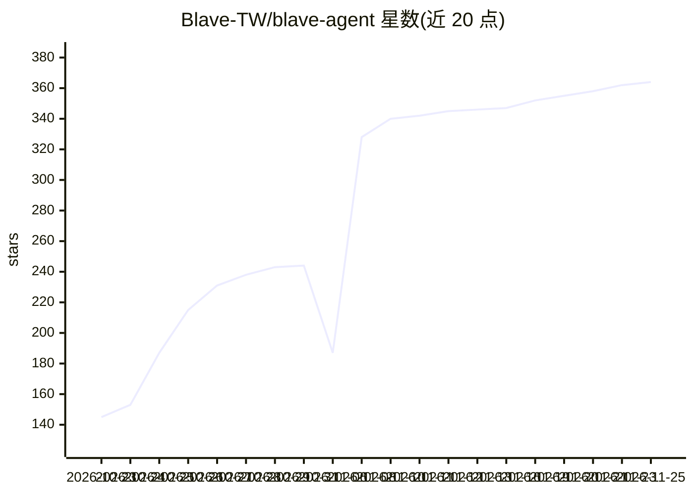

# Blave-TW/blave-agent

⭐ 364 · Python · Apache-2.0 · 推送 2026-11-24 · [GitHub](https://github.com/Blave-TW/blave-agent) · [官网](https://blave.org) · 组织维护 · 中文 README

**让 Claude Code/Codex 把交易想法变成回测策略并实盘运行的桌面工作台**

面向 macOS 与 Windows 的开源桌面工作区（Electron），用户用自然语言描述交易想法，由 Claude Code、Codex、DeepSeek key 或 Blave AI 生成策略并完成回测、参数扫描与实盘交易。内置过拟合检验（MCPT p-value、参数平台、walk-forward）、默认计入手续费、对接 Binance/OKX/Bybit 等交易所自动交易，支持无需 API key 的模拟盘，并可读取网页返回可回测的策略想法。资金分配与恢复交易仅由用户操作，agent 只能停止。提供付费云托管使策略在关机后继续运行。

## 筛选速览

| 维度 | 判定 | 备注 |
|---|---|---|
| AI 角色 | `ai-native` | 本体是模型或模型工具 |
| 许可风险 | `permissive` | Apache-2.0 |
| 部署形态 | `library` | 以包/库形式分发 |
| 模型依赖 | locked-api |  |
| 硬件要求 | — | 无带数字的原话,不猜 |
| 安装摩擦 | `low` | 无编译、无系统依赖或容器化 |
| 成熟度 | — | 结构信号不足 |

## 能力要点

- 自然语言描述策略，AI 生成并回测（SMA 交叉等示例）
- 过拟合检验：MCPT p-value、参数平台、walk-forward
- 对接 Binance、OKX、Bybit、BingX、Gate.io、Bitget 及台指期自动交易
- 每笔订单与交易所核对并记录到 state/audit.jsonl

## 适用场景

- 把一个 BTC 突破策略想法快速变成回测结果
- 在模拟盘上无 key 试运行交易策略
- 对加密货币与台股做参数扫描寻找稳健参数
- 关机后通过云托管继续运行策略并用 Telegram 查看

## 场景标签

`金融量化` · 领域:学习与行业

## 证据(README 行号)

> L3: **Turn Trading Ideas Into Quant Strategies with AI**
> L24: - **Pick your AI.** Claude Code, Codex, a DeepSeek key, or Blave AI.

## 星数曲线

2026-10-23 145 → 2026-11-25 364（+219）

---
*卡片 v1 · prompt 1.4 · 生成 2026-11-25 · 置信度 high · 依据 README sha `6cc66dd64b74` · [字段定义](../../DATASET.md)*
