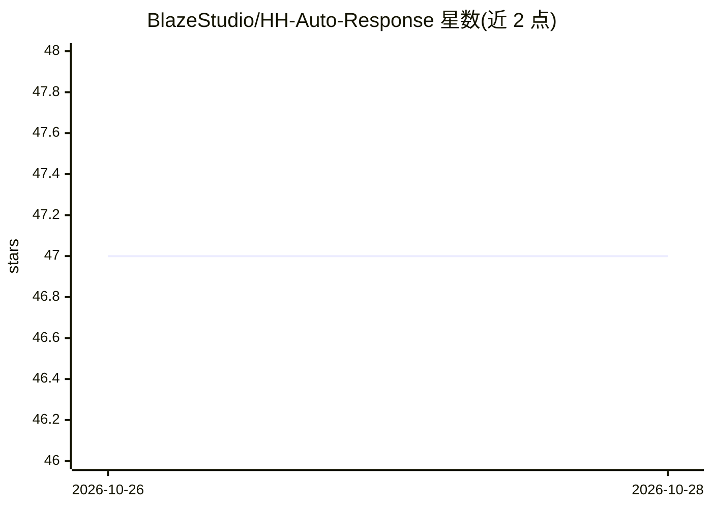

# BlazeStudio/HH-Auto-Response

⭐ 47 · Python · NOASSERTION · 推送 2026-10-27 · [GitHub](https://github.com/BlazeStudio/HH-Auto-Response) · 个人维护

**面向求职者的 hh.ru 自动投递桌面工具：AI 写信、填问卷、处理聊天**

本地运行的 hh.ru 求职自动化程序：按用户筛选条件遍历职位列表逐个投递，附信可由 LLM 按具体职位生成（或用模板/不带附信），用 LLM 根据简历填写雇主问卷，读取聊天中的拒绝信息并回复雇主机器人，同时保留真人对话和文档/财务事项给用户。还支持简历排名提升（每4小时）、日程自动启动、公司限额、漏斗和 Excel 报告，及基于 LLM 的 JD 与自定义描述匹配过滤器。有适用于 Windows/macOS/Linux 的图形界面程序、命令行脚本和用于服务器的 Docker 镜像；浏览器在后台运行，需要 Chrome/Edge，登录和验证码不自动处理。

## 筛选速览

| 维度 | 判定 | 备注 |
|---|---|---|
| AI 角色 | `ai-enhanced` | 去掉 AI 部分产品仍成立 |
| 许可风险 | `none` | NOASSERTION |
| 部署形态 | `desktop` | 安装包/桌面程序 |
| 模型依赖 | local-ok | 支持本地模型 |
| 硬件要求 | — | 无带数字的原话,不猜 |
| 安装摩擦 | `low` | 无编译、无系统依赖或容器化 |
| 成熟度 | — | 结构信号不足 |

## 能力要点

- 基于 LLM 为每个具体职位生成附信，并使用简历填写雇主问卷
- 基于 LLM 的过滤器：在申请前将 JD 与自由文本职位描述进行匹配
- 聊天自动化：读取拒绝信息、回答雇主机器人问卷、将真人对话留给用户
- 自动更新、漏斗统计与 Excel 报告、Telegram/桌面通知

## 适用场景

- 自动化回复 hh.ru 上的匹配职位或搜索查询
- 使用 LLM 撰写个性化附信并完成雇主问卷
- 跟踪申请漏斗：邀请、拒绝及跳过原因

## 场景标签

`浏览器自动化` `AI 写作` · 领域:效率与自动化

## 证据(README 行号)

> L15: ваши фильтры. Письмо берётся из кнопки hh «Сгенерировать», пишется нейросетью под конкретную вакансию,
> L56: - ИИ-фильтр: перед откликом нейросеть читает карточку и сверяет её с вашим описанием своими словами

## 星数曲线

2026-10-26 47 → 2026-10-28 47（+0）

---
*卡片 v1 · prompt 1.4 · 生成 2026-10-27 · 置信度 mid · 依据 README sha `335d16ec1fbb` · [字段定义](../../DATASET.md)*
