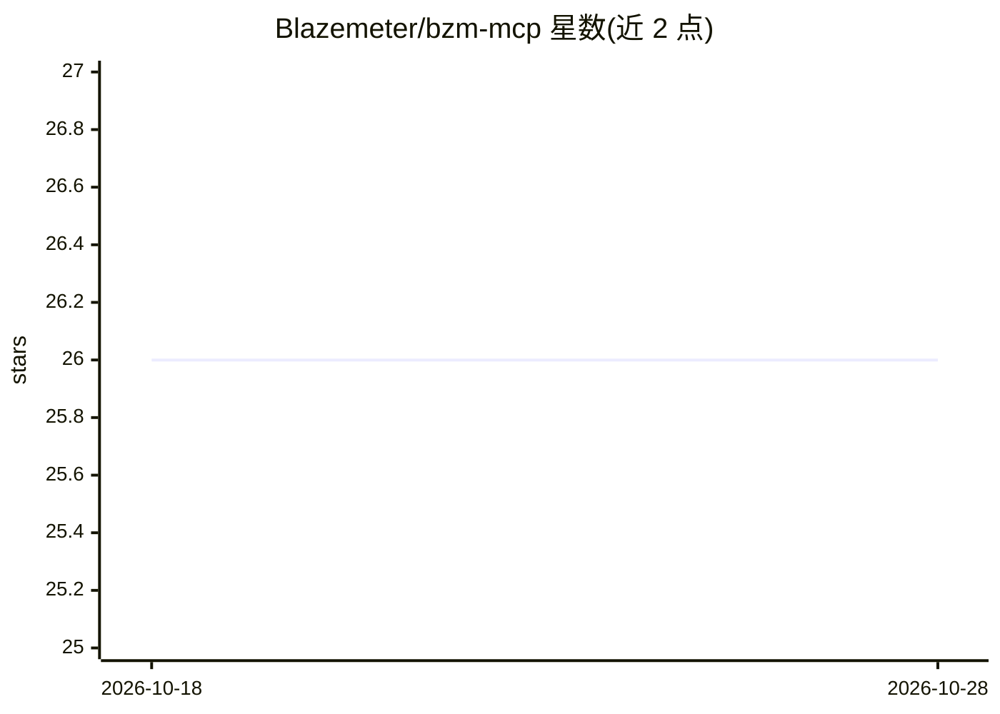

# Blazemeter/bzm-mcp

⭐ 26 · Python · Apache-2.0 · 推送 2026-10-26 · [GitHub](https://github.com/Blazemeter/bzm-mcp) · [官网](https://help.blazemeter.com/docs/guide/integrations-blazemeter-mcp-server.html) · 组织维护

**官方 BlazeMeter MCP 服务器：让 AI 助手管理云负载测试**

Perforce/BlazeMeter 官方发布的 MCP 服务器，把 AI 工具（VS Code、Claude Desktop、Cursor、Windsurf 等 MCP 宿主）接入 BlazeMeter 云性能测试平台，通过自然语言完成从测试创建、执行到报告的完整负载测试流程。需 BlazeMeter API 凭据并同意 AI 条款；提供三进制发行版、uvx 源码安装与 Docker 部署三种方式。内置基于 OpenTelemetry 的遥测（默认开启，上报工具调用 trace 与指标，可用 OTEL_SDK_DISABLED=true 或 --no-telemetry 关闭），支持企业自签 CA 证书配置。

## 筛选速览

| 维度 | 判定 | 备注 |
|---|---|---|
| AI 角色 | `ai-ecosystem` | LLM/agent 周边工具 |
| 许可风险 | `permissive` | Apache-2.0 |
| 部署形态 | `desktop` | 安装包/桌面程序 |
| 模型依赖 | — | README 未给出锁定关系 |
| 硬件要求 | — | 无带数字的原话,不猜 |
| 安装摩擦 | `low` | 无编译、无系统依赖或容器化 |
| 成熟度 | — | 结构信号不足 |

## 能力要点

- 通过 MCP 协议让 AI 代理管理完整负载测试工作流
- 提供三进制、uvx（Python 3.11+）与 Docker 三种部署方式
- 内置 OpenTelemetry 遥测，记录每次 MCP 工具调用的 trace 与指标
- 支持企业代理/自签 CA 证书环境（SSL_CERT_FILE 配置）

## 适用场景

- 在 Cursor/VS Code/Claude Desktop 中用自然语言驱动 BlazeMeter 压测
- 让 AI 助手创建、执行并查看性能测试报告
- 企业内网 SSL 环境下接入 BlazeMeter 测试平台

## 场景标签

 · 领域:性能测试/DevOps

## 证据(README 行号)

> L5: The BlazeMeter MCP Server connects AI tools directly to BlazeMeter's cloud-based performance testing platform. This 
> L141: BlazeMeter MCP reports traces and metrics for MCP tool calls using OpenTelemetry. This gives you visibility into w

## 星数曲线

2026-10-18 26 → 2026-10-28 26（+0）

---
*卡片 v1 · prompt 1.4 · 生成 2026-10-26 · 置信度 high · 依据 README sha `71614b19c001` · [字段定义](../../DATASET.md)*
