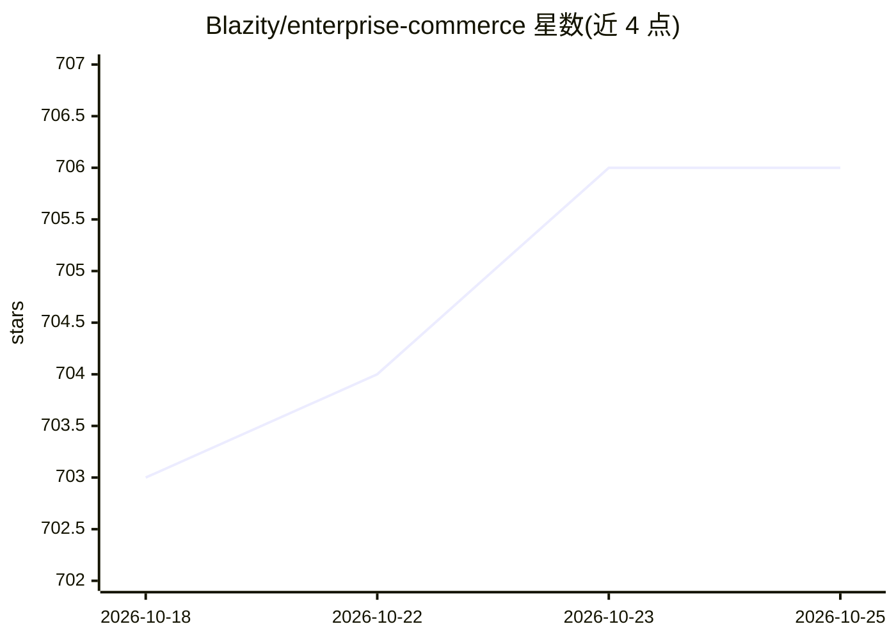

# Blazity/enterprise-commerce

⭐ 705 · TypeScript · MIT · 推送 2026-10-23 · [GitHub](https://github.com/Blazity/enterprise-commerce) · [官网](https://next-enterprise-commerce.vercel.app) · 组织维护

**面向企业的 Next.js 电商店面模板：Shopify 后端 + Algolia 中间层**

由 Blazity 维护的开源企业级电商店面模板：以 Next.js（App Router）构建，Shopify 承担商品数据与类目，Algolia 作为中间层负责数据获取、搜索、分面与推荐。覆盖首页/类目页/商品列表页/商品详情页/搜索结果页，各自定义渲染与缓存策略（SSG/ISR/PPR/CSR 组合）；含 Bloom Filter 实现的重定向处理、无 JS 可见的关键内容、A/B 测试与分析接入。安装需查阅 docs.blazity.com 的 Setup & Configuration，支持一键部署到 Vercel。

## 筛选速览

| 维度 | 判定 | 备注 |
|---|---|---|
| AI 角色 | `ai-enhanced` | 去掉 AI 部分产品仍成立 |
| 许可风险 | `permissive` | MIT |
| 部署形态 | `None` |  |
| 模型依赖 | — | README 未给出锁定关系 |
| 硬件要求 | — | 无带数字的原话,不猜 |
| 安装摩擦 | `low` | 无编译、无系统依赖或容器化 |
| 成熟度 | — | 结构信号不足 |

## 能力要点

- Shopify 作电商后端，Algolia 作搜索/分面/推荐中间层
- 按页面类型（HP/CLP/PLP/SRP/PDP）分别定义渲染与缓存策略
- 基于 Bloom Filters 的万级重定向处理
- 关键页面内容无需 JavaScript 执行即可展示（SEO）

## 适用场景

- 企业搭建高性能电商店面，作为 Next.js 项目起点
- 需要处理大量重定向与爬取预算优化的 SEO 场景
- 接入 Algolia 实现大规模商品即时搜索与筛选

## 场景标签

 · 领域:电商/前端模板

## 证据(README 行号)

> L7: Enterprise Commerce by Blazity is a open source enterprise-grade template of a Next.js project using Shopify as the 
> L39: - Shopify as e-commerce backend, Algolia as the data middle-layer

## 星数曲线

2026-10-18 703 → 2026-10-25 706（+3）

---
*卡片 v1 · prompt 1.4 · 生成 2026-10-21 · 置信度 mid · 依据 README sha `bc3e8107a7ba` · [字段定义](../../DATASET.md)*
