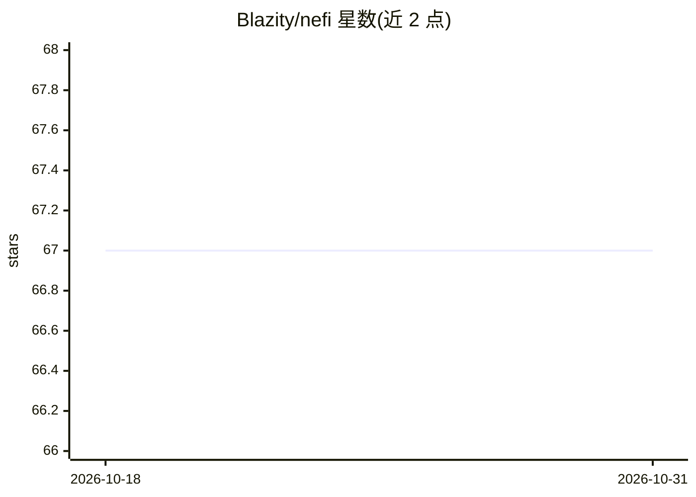

# Blazity/nefi

⭐ 67 · TypeScript · NOASSERTION · 推送 2026-03-16 · [GitHub](https://github.com/Blazity/nefi) · [官网](https://nefi.ai/) · 组织维护

**用自然语言命令自动化 Next.js 代码管理的 AI agent**

面向使用 next-enterprise 模板（主要目标）的 Next.js 项目的开发者工具：通过自然语言命令（如 remove storybook from my project）执行代码管理操作，覆盖 git 操作、包管理与文件修改，减少配置样板与常见维护任务的手工工作。提供 nefi.ai 文档站点了解更多信息，采用 MIT 许可证，由 Blazity 维护。README 未给出安装命令或硬件要求细节。

## 筛选速览

| 维度 | 判定 | 备注 |
|---|---|---|
| AI 角色 | `ai-ecosystem` | LLM/agent 周边工具 |
| 许可风险 | `none` | NOASSERTION |
| 部署形态 | `None` |  |
| 模型依赖 | — | README 未给出锁定关系 |
| 硬件要求 | — | 无带数字的原话,不猜 |
| 安装摩擦 | `low` | 无编译、无系统依赖或容器化 |
| 成熟度 | — | 结构信号不足 |

## 能力要点

- 通过自然语言命令驱动代码操作
- 覆盖 git 操作、包管理与文件修改
- 主要面向 next-enterprise 脚手架的定制

## 适用场景

- 用一句话从 next-enterprise 项目移除不需要的集成
- 通过自然语言集成新功能到 Next.js 代码库
- 让 agent 代为执行 git 与包管理等常规维护任务

## 场景标签

`编码 Agent` · 领域:编码与开发

## 证据(README 行号)

> L3: **nefi /ˈnɛfi/** is an AI agent that automates code management and feature integration in Next.js codebases _(primar
> L9: The whole idea behind this tool is to reduce the amount of manual work and time spent on common tasks like setting u

## 星数曲线

2026-10-18 67 → 2026-10-31 67（+0）

---
*卡片 v1 · prompt 1.4 · 生成 2026-10-24 · 置信度 mid · 依据 README sha `b8345c7a1736` · [字段定义](../../DATASET.md)*
