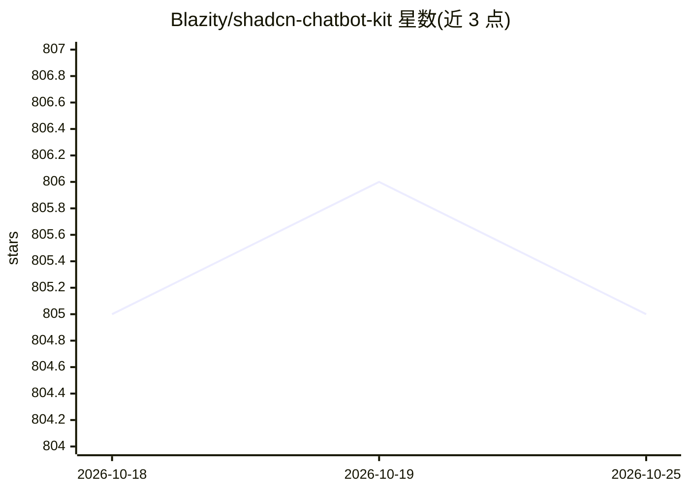

# Blazity/shadcn-chatbot-kit

⭐ 805 · TypeScript · MIT · 推送 2026-02-26 · [GitHub](https://github.com/Blazity/shadcn-chatbot-kit) · [官网](https://shadcn-chatbot-kit.vercel.app) · 组织维护

**给前端开发者：基于 shadcn/ui 的聊天机器人组件套件**

构建在 shadcn/ui 生态之上并与之完全兼容的 React 聊天机器人组件库，面向用 Next.js/React 开发 AI 聊天界面的前端开发者。提供预构建 Chat 组件、消息输入（自动伸缩、文件上传与预览）、附件智能预览、Markdown 语法高亮、工具执行状态可视化、提示建议、加载态、暗/亮主题切换、语音输入（WIP）与思考过程展示（WIP）等。通过 shadcn CLI 按需安装组件，用户保留组件所有权，可用 CSS 变量完全定制。Quick Start 示例基于 Vercel AI SDK 的 useChat。

## 筛选速览

| 维度 | 判定 | 备注 |
|---|---|---|
| AI 角色 | `ai-ecosystem` | LLM/agent 周边工具 |
| 许可风险 | `permissive` | MIT |
| 部署形态 | `None` |  |
| 模型依赖 | — | README 未给出锁定关系 |
| 硬件要求 | — | 无带数字的原话,不猜 |
| 安装摩擦 | `low` | 无编译、无系统依赖或容器化 |
| 成熟度 | — | 结构信号不足 |

## 能力要点

- 预构建 Chat 组件与可组合式组件 API
- 附件预览、文件上传、Markdown 语法高亮
- 工具执行状态可视化与取消/中断提示
- shadcn CLI 按需安装，CSS 变量完全定制主题

## 适用场景

- 在 React/Next.js 项目中快速搭建 AI 聊天界面
- 用熟悉的 shadcn/ui 体系定制自己的聊天机器人组件
- 为 LLM 应用添加附件上传与工具执行状态展示

## 场景标签

`聊天机器人` · 领域:对话与助手

## 证据(README 行号)

> L3: A comprehensive chatbot component kit built on top of and fully compatible with the shadcn/ui ecosystem. Build beaut
> L60: **Note:** This example uses the Vercel AI SDK. Follow the official Getting Started guide, before using it.

## 星数曲线

2026-10-18 805 → 2026-10-25 805（+0）

---
*卡片 v1 · prompt 1.4 · 生成 2026-10-22 · 置信度 high · 依据 README sha `813eef099802` · [字段定义](../../DATASET.md)*
