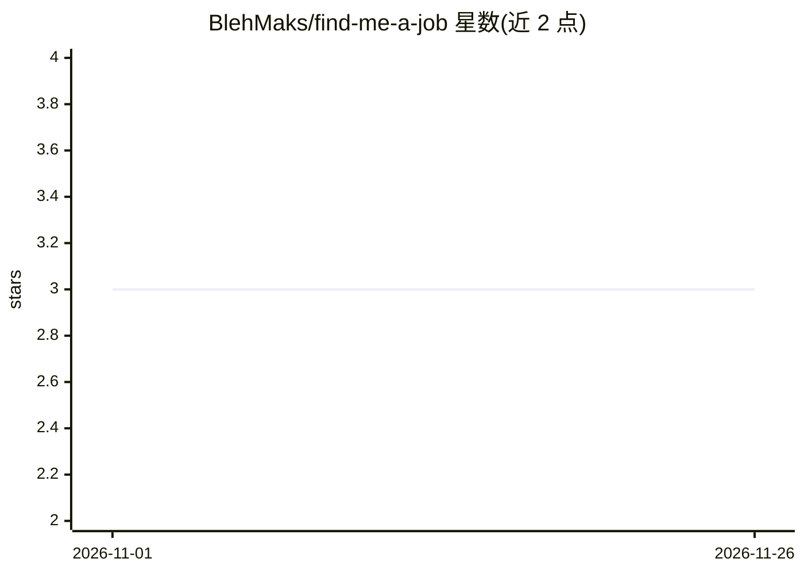

# BlehMaks/find-me-a-job

⭐ 3 · Python · MIT · 推送 2026-11-03 · [GitHub](https://github.com/BlehMaks/find-me-a-job) · [官网](https://blehmaks.github.io/find-me-a-job/) · 个人维护

**把 Codex/Claude Code 变成求职助手：定制简历并跟踪投递**

以源码工作区 + AGENTS.md 形式提供的求职工作流：在 Codex 或 Claude Code 中运行，从旧简历或对话中整理用户经历，生成定制 CV 与求职信并检查 PDF 文本排版，跨雇主官网、招聘板、LinkedIn 与邮件提醒搜索职位并跟踪投递与回复。支持行业/学术/创意三类 CV 结构，无需托管账号。桌面安装器捆绑 Python，源码路径需 Python 3.11+、Git、XeLaTeX 与 Poppler。作者另以付费方式代为运行求职流程。

## 筛选速览

| 维度 | 判定 | 备注 |
|---|---|---|
| AI 角色 | `ai-native` | 本体是模型或模型工具 |
| 许可风险 | `permissive` | MIT |
| 部署形态 | `desktop` | 安装包/桌面程序 |
| 模型依赖 | — | README 未给出锁定关系 |
| 硬件要求 | — | 无带数字的原话,不猜 |
| 安装摩擦 | `low` | 无编译、无系统依赖或容器化 |
| 成熟度 | `idea` | |

## 能力要点

- 从旧 CV/项目笔记/对话学习用户经历并确认事实
- 生成定制 CV 与求职信，含 PDF 文本与排版检查
- 跨雇主官网、招聘板、LinkedIn 与邮件提醒搜索职位
- 跟踪投递与回复、恢复受阻步骤并准备面试

## 适用场景

- 为自己的求职准备针对各职位的定制简历与求职信
- 在多个招聘渠道统一跟踪投递与回复进度
- 为行业、学术或创意类职业生成对应结构的 CV

## 场景标签

`工作流自动化` `AI 写作` · 领域:效率与自动化

## 证据(README 行号)

> L9: Turn Codex or Claude Code into a job-search assistant that knows your experience, prepares tailored CVs and helps yo
> L16: - **Prepare each application.** Get a tailored CV and a cover letter when needed, with checks on the PDF's text and
> L79: The agent can walk you through the source setup. Python 3.11+, Git, XeLaTeX and Poppler are needed for the full doc

## 星数曲线

2026-11-01 3 → 2026-11-26 3（+0）

---
*卡片 v1 · prompt 1.4 · 生成 2026-11-22 · 置信度 high · 依据 README sha `2522b3b7cbe5` · [字段定义](../../DATASET.md)*
