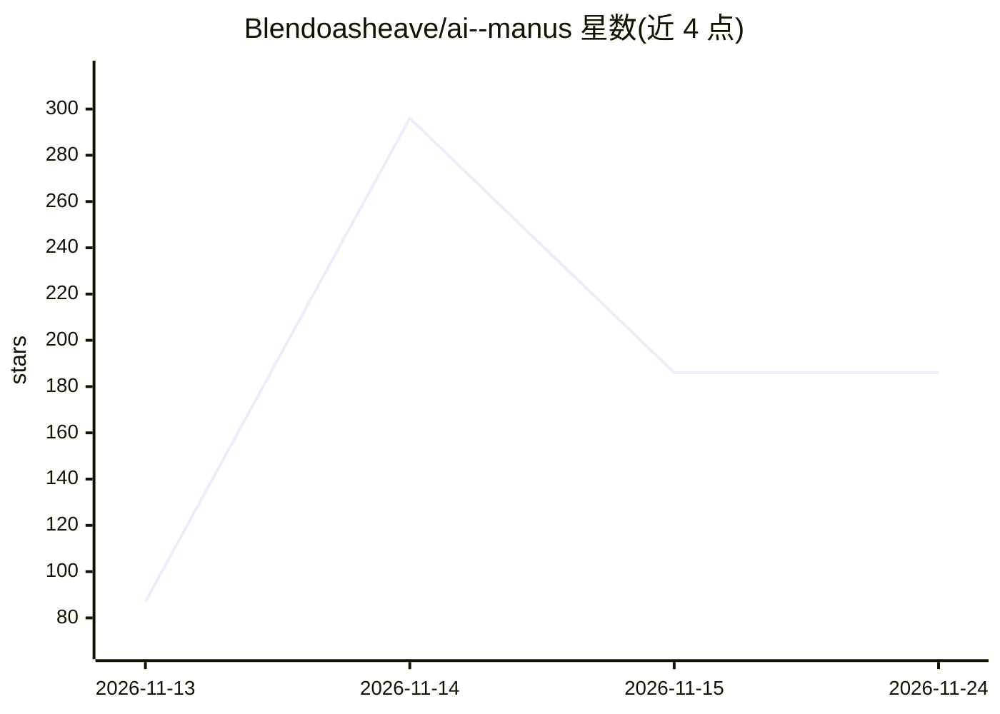

# Blendoasheave/ai--manus

⭐ 186 · Apache-2.0 · 推送 2026-11-15 · [GitHub](https://github.com/Blendoasheave/ai--manus) · 个人维护

**自主 AI Agent：代用户执行代码与控制浏览器完成任务**

面向家庭、学习与轻量办公场景的自主 AI Agent 系统，在沙箱环境中运行代码并控制浏览器：可编写执行脚本、打开网页、填写表单、采集信息并执行多步骤任务，代码与浏览器操作可在同一流程中衔接。README 描述其定位为非重度企业平台的小型助手，支持跨会话保持任务模式。值得注意的是，README 仅包含营销式描述与笼统的硬件兼容表，未提供安装命令、源码入口或技术实现细节，实际可用性无法从 README 验证。

## 筛选速览

| 维度 | 判定 | 备注 |
|---|---|---|
| AI 角色 | `ai-native` | 本体是模型或模型工具 |
| 许可风险 | `permissive` | Apache-2.0 |
| 部署形态 | `None` |  |
| 模型依赖 | — | README 未给出锁定关系 |
| 硬件要求 | — | 无带数字的原话,不猜 |
| 安装摩擦 | `low` | 无编译、无系统依赖或容器化 |
| 成熟度 | — | 结构信号不足 |

## 能力要点

- 自主执行代码：Agent 自行编写并运行脚本完成任务
- 浏览器控制：导航网页、填写表单、采集信息
- 代码与浏览器操作在同一任务流程中衔接
- 沙箱环境中运行各类工具与操作

## 适用场景

- 让学生整理研究笔记、跑快速计算
- 让远程工作者从多个网页采集数据
- 把重复的小任务（查页面、整理文件）交给后台代理

## 场景标签

`浏览器自动化` · 领域:效率与自动化

## 证据(README 行号)

> L10: - **Autonomous Code Execution:** Manus AI agent runs code on its own to complete tasks, so you can focus on decisio
> L18: Manus is an autonomous AI agent designed to run code and control a browser on your behalf. Instead of acting like a

## 星数曲线

2026-11-13 87 → 2026-11-24 186（+99）

---
*卡片 v1 · prompt 1.4 · 生成 2026-11-17 · 置信度 low · 依据 README sha `a3d88e202bf0` · [字段定义](../../DATASET.md)*
