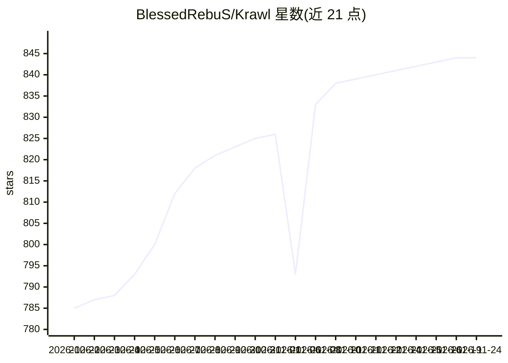

# BlessedRebuS/Krawl

⭐ 844 · Python · MIT · 推送 2026-11-21 · [GitHub](https://github.com/BlessedRebuS/Krawl) · [官网](https://demo.krawlme.com/das_dashboard) · 个人维护

**面向蓝队的 Web 蜜罐/欺骗服务器：诱捕攻击者与爬虫**

Krawl 是一个可定制、云原生的 Web 欺骗服务器与反爬虫蜜罐：生成含假管理员面板、假配置文件与假凭据的仿真实 Web 应用，配合 spider 陷阱、robots.txt 蜜罐路径与 canary token 检测、延迟并分析恶意攻击者、爬虫与自动扫描器。内置 3,100+ 条 YARA 规则识别 SQLi/XSS/SSF 等攻击并返回假响应，仪表盘支持攻击画像、IP 信誉评分、封禁列表导出与 Cloudflare 同步。AI 用于生成欺骗页面。部署支持 Docker、Docker Compose、Kubernetes/Helm 与 Python/uvicorn 运行。

## 筛选速览

| 维度 | 判定 | 备注 |
|---|---|---|
| AI 角色 | `ai-enhanced` | 去掉 AI 部分产品仍成立 |
| 许可风险 | `permissive` | MIT |
| 部署形态 | `self-host` | docker 或自建部署 |
| 模型依赖 | — | README 未给出锁定关系 |
| 硬件要求 | — | 无带数字的原话,不猜 |
| 安装摩擦 | `low` | 无编译、无系统依赖或容器化 |
| 成熟度 | — | 结构信号不足 |

## 能力要点

- AI 生成欺骗页面，攻击者访问即扩大假攻击面
- YARA 攻击检测：3,100+ 规则覆盖 2,500+ CVE 并配假响应
- IP 信誉五信号评分与每周发布的社区封禁列表
- 两种部署模式：Standalone（SQLite）与 Scalable（PostgreSQL+Redis）

## 适用场景

- 为生产服务前置一层蜜罐，掩护真实业务并收集攻击情报
- 消耗恶意爬虫资源并区分恶意与良性爬虫
- 导出封禁列表自动对接防火墙与 Cloudflare WAF 拦截攻击 IP

## 场景标签

`网络安全` · 领域:学习与行业

## 证据(README 行号)

> L8:  A modern, customizable web honeypot server designed to detect and track malicious activity from attackers and web c
> L42: **Krawl** is a cloud‑native deception server designed to detect, delay, and analyze malicious attackers, web crawle
> L52: - **AI Generated Deception Pages**: **Let attackers help generate your fake vulnerable attack surface**

## 星数曲线

2026-10-22 785 → 2026-11-24 844（+59）

---
*卡片 v1 · prompt 1.4 · 生成 2026-11-24 · 置信度 high · 依据 README sha `a0edf8eaf279` · [字段定义](../../DATASET.md)*
