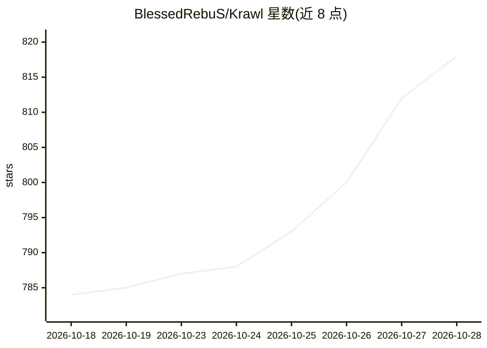

# BlessedRebuS/Krawl

⭐ 821 · Python · MIT · 推送 2026-10-28 · [GitHub](https://github.com/BlessedRebuS/Krawl) · [官网](https://demo.krawlme.com/das_dashboard) · 个人维护

**云原生 Web 蜜罐服务器：用假应用与 AI 生成页面诱捕攻击者与爬虫**

面向安全防御（蓝队）的 Web 欺骗服务器：生成含虚假管理面板、配置文件、假凭据的仿真 Web 应用来吸引并识别攻击者、爬虫与自动化扫描器，功能包括蜘蛛陷阱、蜜罐路径、金丝雀令牌、随机服务器头与实时仪表盘。AI 部分用于生成欺骗页面。支持 Standalone（SQLite，零外部依赖）与 Scalable（PostgreSQL+Redis，水平扩展）两种模式，可通过 Docker、Docker Compose、Kubernetes/Helm 或 Uvicorn 部署，并提供周更的攻击者 IP 封禁清单联邦共享机制。

## 筛选速览

| 维度 | 判定 | 备注 |
|---|---|---|
| AI 角色 | `ai-enhanced` | 去掉 AI 部分产品仍成立 |
| 许可风险 | `permissive` | MIT |
| 部署形态 | `self-host` | docker 或自建部署 |
| 模型依赖 | — | README 未给出锁定关系 |
| 硬件要求 | — | 无带数字的原话,不猜 |
| 安装摩擦 | `low` | 无编译、无系统依赖或容器化 |
| 成熟度 | — | 结构信号不足 |

## 能力要点

- 生成假登录页、假凭据与蜜罐路径的欺骗面，含 AI 生成页面
- 六页签实时仪表盘：攻击类型、TLSH 载荷分组、IP 取证视图、封禁管理
- Standalone/Scalable 双部署模式，Helm 默认附带 PostgreSQL+Redis
- 周更 banlist 并支持实例间封禁清单联邦共享

## 适用场景

- 部署蜜罐诱捕并分析针对 Web 服务的攻击与恶意爬虫
- 通过仪表盘做攻击活动的监控与 IP 取证
- 获取并共享已知恶意 IP 封禁清单用于防火墙联动

## 场景标签

`网络安全` · 领域:学习与行业

## 证据(README 行号)

> L8:  A modern, customizable web honeypot server designed to detect and track malicious activity from attackers and web c
> L36: **Krawl** is a cloud‑native deception server designed to detect, delay, and analyze malicious attackers, web crawle
> L46: - **AI Generated Deception Pages**: **Let attackers help generate your fake vulnerable attack surface**

## 星数曲线

2026-10-18 784 → 2026-10-28 818（+34）

---
*卡片 v1 · prompt 1.4 · 生成 2026-10-21 · 置信度 mid · 依据 README sha `962c94b06929` · [字段定义](../../DATASET.md)*
