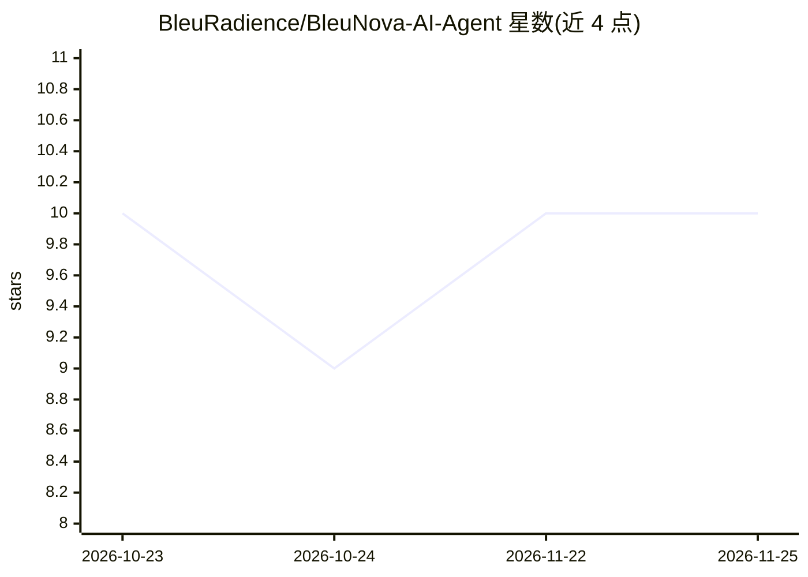

# BleuRadience/BleuNova-AI-Agent

⭐ 10 · Python · MIT · 推送 2026-06-01 · [GitHub](https://github.com/BleuRadience/BleuNova-AI-Agent) · 组织维护

**自托管个人 AI 代理的教育演示版：文本问答连接 LLM API**

一个基础 AI 代理结构的教育性演示/概念验证：当前版本 1.0.0-public 展示代理如何接入 LLM API（Claude、Grok）并处理文本任务（简单问答）。仓库声明这不是生产就绪的自治代理，多代理编排、记忆与持续学习、工具调用、任务规划、IoT 控制、多模态等特性被明确列为不在公共版中、属企业版范畴。运行需 Python 3.11+，Docker 可选，API key 可选。

## 筛选速览

| 维度 | 判定 | 备注 |
|---|---|---|
| AI 角色 | `ai-native` | 本体是模型或模型工具 |
| 许可风险 | `permissive` | MIT |
| 部署形态 | `None` |  |
| 模型依赖 | locked-api |  |
| 硬件要求 | — | 无带数字的原话,不猜 |
| 安装摩擦 | `low` | 无编译、无系统依赖或容器化 |
| 成熟度 | `idea` | |

## 能力要点

- 接入 Claude 与 Grok API 处理文本问答
- 支持 .env 环境配置与 Docker 容器运行
- 公共版与企业版功能对照表，标注未包含特性

## 适用场景

- 学习基础 AI 代理的代码结构
- 体验 Claude/Grok API 的接入方式

## 场景标签

 · 领域:AI Agent

## 证据(README 行号)

> L10: This is a **simple, educational demonstration** of a basic AI agent structure. It shows how an agent can connect to
> L12: **This is NOT a production-ready autonomous agent.**
> L20: |Basic text processing|✅ Working|Simple Q&A|

## 星数曲线

2026-10-23 10 → 2026-11-25 10（+0）

---
*卡片 v1 · prompt 1.4 · 生成 2026-11-20 · 置信度 high · 依据 README sha `f86503fc8f9a` · [字段定义](../../DATASET.md)*
