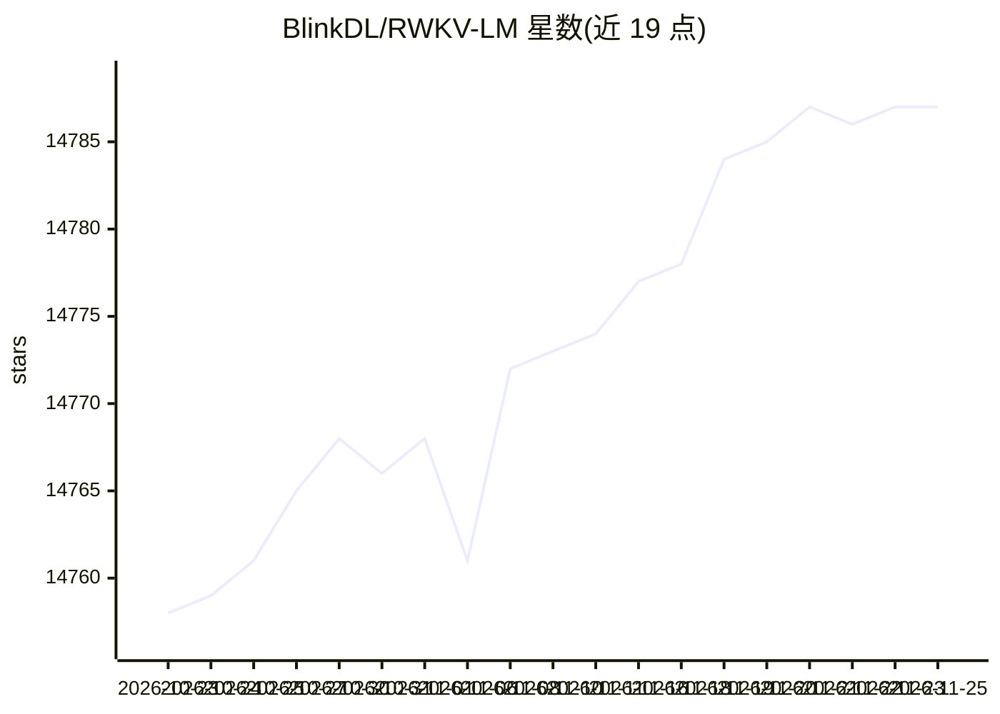

# BlinkDL/RWKV-LM

⭐ 14,787 · Python · Apache-2.0 · 推送 2026-11-04 · [GitHub](https://github.com/BlinkDL/RWKV-LM) · 个人维护

**RWKV 线性 RNN 架构官方实现：训练与推理语言模型**

RWKV 的官方模型实现仓库，当前版本为 RWKV-7 "Goose"，定位为线性时间、常数显存（无 kv-cache）、无注意力机制的 RNN 架构，可像 GPT transformer 一样并行训练。仓库提供 RWKV-7 参考训练代码（train_temp）、多种推理 demo（GPT/RNN/混合模式）、CUDA kernel、MiniPile 与 Pile 数据集训练脚本及 SFT 流程说明，并汇总权重下载、GGUF、移动端推理库、评测代码等周边链接。项目隶属 Linux Foundation AI。

## 筛选速览

| 维度 | 判定 | 备注 |
|---|---|---|
| AI 角色 | `ai-native` | 本体是模型或模型工具 |
| 许可风险 | `permissive` | Apache-2.0 |
| 部署形态 | `library` | 以包/库形式分发 |
| 模型依赖 | local-ok | 支持本地模型 |
| 硬件要求 | `gpu-8g` | |
| 安装摩擦 | `high` | 编译与系统依赖俱全 |
| 成熟度 | — | 结构信号不足 |

## 动量与使用信号

- 维护:`active` — 距上次 push 19.6 天,年发版 0,6 位贡献者
- 涨星:近 1 天 **-1**(自 20261016 起算)
- 下载:GitHub Release 附件 累计 637(5 个 release)
- 平台:WINDOWS / LINUX · 协议:—

## 能力要点

- RWKV-7 参考训练实现，单卡 7G 显存即可运行默认配置
- 提供 GPT 模式、RNN 模式与混合模式三种推理 demo 代码
- 附 CUDA kernel、MiniPile/Pile 训练脚本与训练稳定性建议
- 汇总权重、GGUF、移动端推理库、评测（MMLU/MATH500 等）资源链接

## 适用场景

- 从头预训练或微调 RWKV 系列语言模型
- 在单卡环境下试跑 RWKV-7 训练流程
- 对比 RNN 与 transformer 架构的语言建模实现

## 场景标签

`模型训练` `微调` · 领域:训练与推理

## 证据(README 行号)

> L1: # RWKV: Parallelizable RNN with Transformer-level LLM Performance (pronounced as "RwaKuv" (rʌkuv in IPA), from 4 maj
> L11: RWKV-7 "Goose" is a strong **linear-time** & **constant-space** (no kv-cache) & **attention-free** & 100% RNN archi
> L47: **Please use https://github.com/BlinkDL/RWKV-LM/tree/main/RWKV-v7/train_temp as RWKV-7 reference implementation**. 

## 星数曲线

2026-10-23 14,758 → 2026-11-25 14,787（+29）

---
*卡片 v1 · prompt 1.4 · 生成 2026-11-22 · 置信度 high · 依据 README sha `633debb8eaa0` · [字段定义](../../DATASET.md)*
