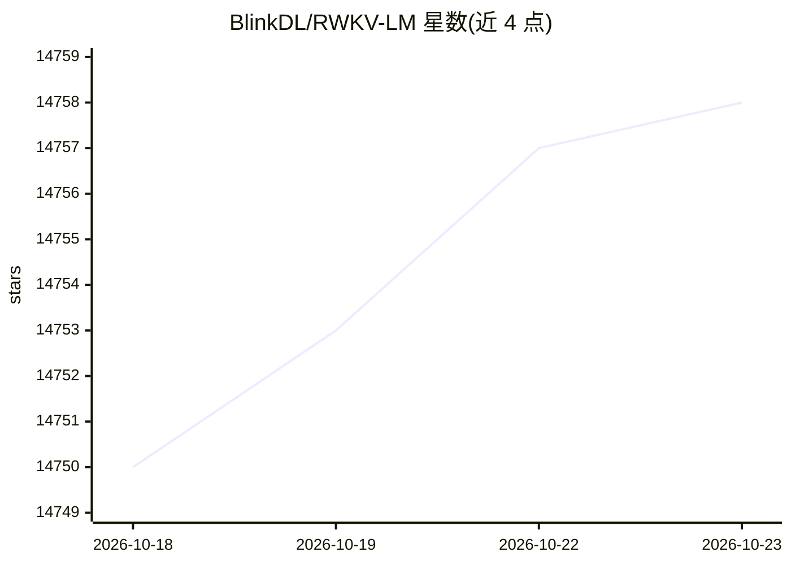

# BlinkDL/RWKV-LM

⭐ 14,758 · Python · Apache-2.0 · 推送 2026-09-28 · [GitHub](https://github.com/BlinkDL/RWKV-LM) · 个人维护

**RWKV 线性 RNN 语言模型的参考实现与训练指南**

RWKV 语言模型架构的主仓库，当前为 RWKV-7 "Goose"：一种线性时间、常数空间（无 kv-cache）、无 attention 的 100% RNN 架构，可像 GPT transformer 一样并行训练。仓库提供 RWKV-v7 参考训练实现（train_temp）、CUDA kernel、MiniPile/Pile 训练流程、参数初始化表，以及 demo 代码与推理评测链接；并列出权重（HuggingFace）、GGUF、pip 包、GUI 运行器、服务器等周边生态。训练参考配置最低 1 GPU 7G 显存。

## 筛选速览

| 维度 | 判定 | 备注 |
|---|---|---|
| AI 角色 | `ai-native` | 本体是模型或模型工具 |
| 许可风险 | `permissive` | Apache-2.0 |
| 部署形态 | `library` | 以包/库形式分发 |
| 模型依赖 | — | README 未给出锁定关系 |
| 硬件要求 | `gpu-8g` | |
| 安装摩擦 | `high` | 编译与系统依赖俱全 |
| 成熟度 | — | 结构信号不足 |

## 动量与使用信号

- 维护:`active` — 距上次 push 19.6 天,年发版 0,6 位贡献者
- 涨星:近 1 天 **-1**(自 20261016 起算)
- 下载:GitHub Release 附件 累计 637(5 个 release)
- 平台:WINDOWS / LINUX · 协议:—

## 能力要点

- RWKV-7：线性时间、常数空间、无 kv-cache 的 RNN 架构，可并行训练
- 提供 train_temp 参考实现，默认配置 1 GPU 7G 显存即可运行
- 提供 CUDA kernel 仓库与推理评测代码（MMLU、MATH500 等）
- README 含 MiniPile/Pile 训练教程与逐参数初始化/权重衰减表

## 适用场景

- 从零训练或微调 RWKV 系列语言模型
- 研究线性注意力/RNN 架构的实现细节
- 部署 RWKV 模型推理（桌面/移动/服务器途径）

## 场景标签

`模型训练` · 领域:训练与推理

## 证据(README 行号)

> L1: # RWKV: Parallelizable RNN with Transformer-level LLM Performance (pronounced as "RwaKuv" (rʌkuv in IPA), from 4 maj
> L11: RWKV-7 "Goose" is a strong **linear-time** & **constant-space** (no kv-cache) & **attention-free** & 100% RNN archi
> L45: **Please use https://github.com/BlinkDL/RWKV-LM/tree/main/RWKV-v7/train_temp as RWKV-7 reference implementation**. 

## 星数曲线

2026-10-18 14,750 → 2026-10-23 14,758（+8）

---
*卡片 v1 · prompt 1.4 · 生成 2026-10-18 · 置信度 high · 依据 README sha `748252d1162e` · [字段定义](../../DATASET.md)*
