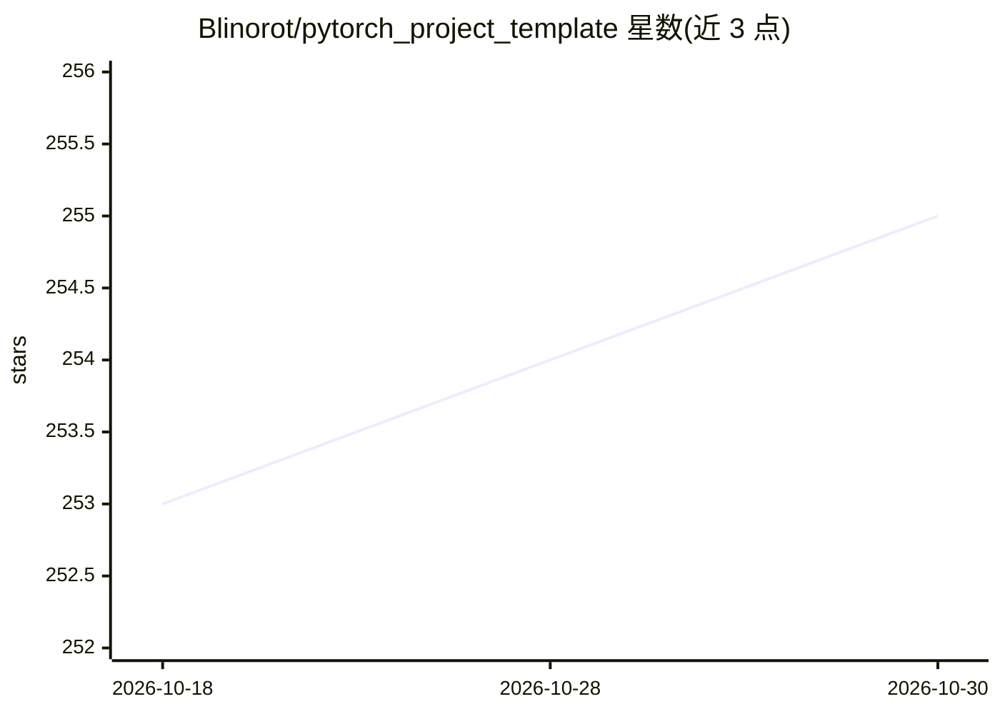

# Blinorot/pytorch_project_template

⭐ 255 · Python · MIT · 推送 2026-05-19 · [GitHub](https://github.com/Blinorot/pytorch_project_template) · 个人维护

**面向深度学习研究者的 PyTorch 项目模板，支持多卡多机训练**

基于 PyTorch 的深度学习项目代码模板：通过 Hydra 做配置管理以增强可复现性，集成 WandB 与 Comet ML 实验跟踪，pre-commit 自动格式化与检查，并提供图像分类、ASR 等已填充示例分支。HF Main 分支加入 HuggingFace 集成，支持多 GPU 与多节点训练、混合精度与梯度累积。模板随 HSE DLA 课程发布，同时是 EPFL CS-333/433 ML 课程官方推荐模板；主分支部分代码留空，由使用者按任务补全。通过 GitHub use this template 按钮生成项目后，用 pip 安装依赖并经 train.py/inference.py 运行。

## 筛选速览

| 维度 | 判定 | 备注 |
|---|---|---|
| AI 角色 | `ai-ecosystem` | LLM/agent 周边工具 |
| 许可风险 | `permissive` | MIT |
| 部署形态 | `library` | 以包/库形式分发 |
| 模型依赖 | — | README 未给出锁定关系 |
| 硬件要求 | — | 无带数字的原话,不猜 |
| 安装摩擦 | `low` | 无编译、无系统依赖或容器化 |
| 成熟度 | — | 结构信号不足 |

## 能力要点

- Hydra 配置管理与 WandB / Comet ML 实验跟踪
- HF Main 分支：HuggingFace 集成，多 GPU 与多节点训练、AMP、梯度累积
- 提供图像分类、ASR 等已完成示例分支
- pre-commit 自动代码格式化与检查

## 适用场景

- 为深度学习科研项目快速搭建可复现的代码骨架
- 课程作业或实验室项目中统一配置与实验记录流程
- 需要多 GPU / 多节点训练的 HF 生态项目起步

## 场景标签

`MLOps` · 领域:训练与推理

## 证据(README 行号)

> L24: This repository contains a template for PyTorch-based Deep Learning projects.
> L32: **New:** we added a HF Main variant of the template with HuggingFace Integration for multi-GPU and multi-node train
> L38: This template utilizes experiment tracking techniques, such as WandB and Comet ML, and Hydra for the configuration.

## 星数曲线

2026-10-18 253 → 2026-10-30 255（+2）

---
*卡片 v1 · prompt 1.4 · 生成 2026-10-22 · 置信度 high · 依据 README sha `be73485fd5a2` · [字段定义](../../DATASET.md)*
