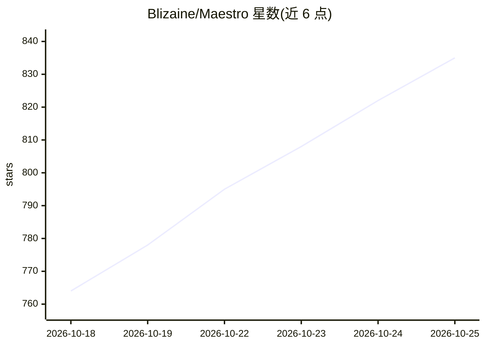

# Blizaine/Maestro

⭐ 835 · Python · NOASSERTION · 推送 2026-10-24 · [GitHub](https://github.com/Blizaine/Maestro) · [官网](https://pinokio.computer) · 个人维护 · 中文 README

**本地一体化 AI 视频/图像/音乐创作工作室，支持 LLM 导演模式**

面向创作者的 100% 本地 AI 创作工具，基于 WanGP 流水线构建，提供图像生成（MOSS Image 5B、Qwen Image 2.1）、视频生成（MiniMax H3、LTX-2.5、Wan 等）、音乐与语音生成（MiniMax-Music3、ACE-Step、YuE2 等）及多轨编辑器。Director 模式由本地 LLM 规划镜头、写剧本歌词并执行多片段生成，支持音乐视频与短片两种技能；首次启动自动检测 GPU/VRAM/RAM 并选择量化与内存方案，提供 8GB 至 24GB VRAM 分级的时长建议。部分模型（Qwen、YuE2）带研究/非商用许可限制。

## 筛选速览

| 维度 | 判定 | 备注 |
|---|---|---|
| AI 角色 | `ai-native` | 本体是模型或模型工具 |
| 许可风险 | `none` | NOASSERTION |
| 部署形态 | `None` |  |
| 模型依赖 | — | README 未给出锁定关系 |
| 硬件要求 | — | 无带数字的原话,不猜 |
| 安装摩擦 | `medium` | 含编译或系统依赖之一 |
| 成熟度 | — | 结构信号不足 |

## 能力要点

- Director 模式：本地 LLM 规划镜头、写剧本歌词并生成完整音乐视频/短片
- 支持图像/视频/音频多类本地模型与 LoRA，含多片段生成与角色一致性
- Performance Auto-Tune 首启自动检测硬件并选择量化/VAE 平铺/内存方案
- 按 GPU 显存/内存分级给出生成时长默认值（8GB 至 24GB VRAM 多档）

## 适用场景

- 从一个提示词自动生成配乐完整的音乐视频或短片
- 本地生成与编辑图像、视频、音乐，不依赖云服务
- 在小显存 GPU 上通过自动调优运行视频生成模型

## 场景标签

`图像生成` `视频生成` · 领域:内容生成

## 证据(README 行号)

> L3: A one-click local AI **creative studio, director, and video editor** for creators. Maestro combines a modern interfa
> L24: The flagship feature. Drop in an audio track or write a story; a local LLM plans every shot, writes screenplays/lyr
> L26: - **Music Video** — beat-aware shot planning aligned to your audio. The LLM analyzes BPM, sections (verse/chorus/br

## 星数曲线

2026-10-18 764 → 2026-10-25 835（+71）

---
*卡片 v1 · prompt 1.4 · 生成 2026-10-21 · 置信度 high · 依据 README sha `48020cad9d4e` · [字段定义](../../DATASET.md)*
