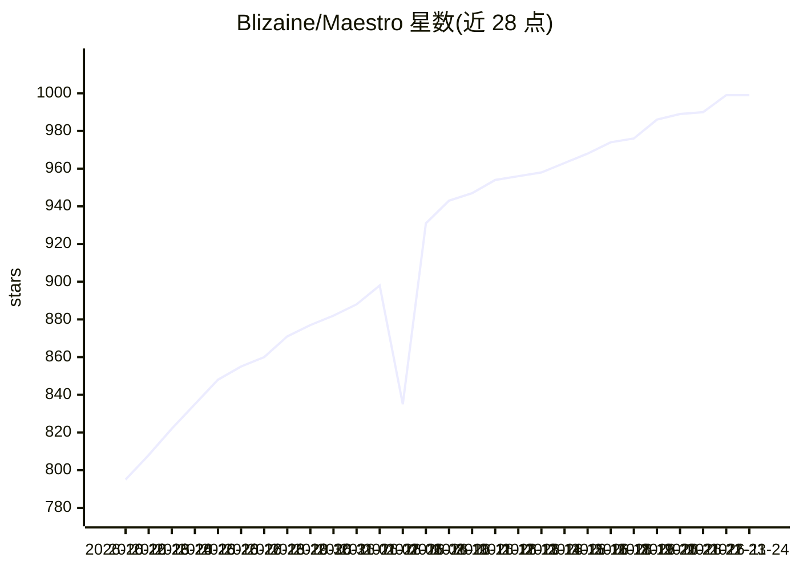

# Blizaine/Maestro

⭐ 1,006 · Python · NOASSERTION · 推送 2026-11-23 · [GitHub](https://github.com/Blizaine/Maestro) · [官网](https://pinokio.computer) · 个人维护

**全本地 AI 视频图像音乐创作工作室，供创作者一键生成**

面向创作者的本地 AI 创作工作室，包含三个模块：Studio 从文本或参考生成视频、图像、音乐、语音与音效；Director 从一首歌或故事自动规划分镜、准备角色参考与关键帧、生成片段并组装成片，支持 Auto/Manual 两种模式；Editor 提供多轨时间线剪辑与导出。内置本地语言/视觉模型辅助写作，提供 MCP 接口供外部 agent 调用。通过 Pinokio 安装，模型首次使用时下载；外部服务与远程访问为可选项。

## 筛选速览

| 维度 | 判定 | 备注 |
|---|---|---|
| AI 角色 | `ai-native` | 本体是模型或模型工具 |
| 许可风险 | `none` | NOASSERTION |
| 部署形态 | `desktop` | 安装包/桌面程序 |
| 模型依赖 | — | README 未给出锁定关系 |
| 硬件要求 | — | 无带数字的原话,不猜 |
| 安装摩擦 | `medium` | 含编译或系统依赖之一 |
| 成熟度 | — | 结构信号不足 |

## 能力要点

- Director 模式从单个提示规划完整音乐视频与短片
- 本地生成视频、图像、音乐、语音、克隆声音与音效
- 内置 MCP，可让外部 agent 提交任务并管理项目
- Auto-Tune 按 GPU/VRAM/RAM 自动选择起始设置

## 适用场景

- 从一首歌生成完整音乐视频
- 本地生成并剪辑短片，无需云服务
- 管理 CivitAI LoRA 与社区模型下载
- 通过 MCP 让 AI agent 代为提交生成任务

## 场景标签

`视频生成` `图像生成` `语音合成` · 领域:内容生成

## 证据(README 行号)

> L3: A one-click local AI **creative studio, director, and video editor** for creators. Maestro combines a modern interfa
> L11: Create with **Studio**, plan a production with **Director**, and finish it in the **Editor**. Local models run on y
> L16: - **Studio — video, images and audio.** Generate from text or references; animate, extend, blend and edit video; cr

## 星数曲线

2026-10-22 795 → 2026-11-24 999（+204）

---
*卡片 v1 · prompt 1.4 · 生成 2026-11-24 · 置信度 high · 依据 README sha `b1fcab23804f` · [字段定义](../../DATASET.md)*
