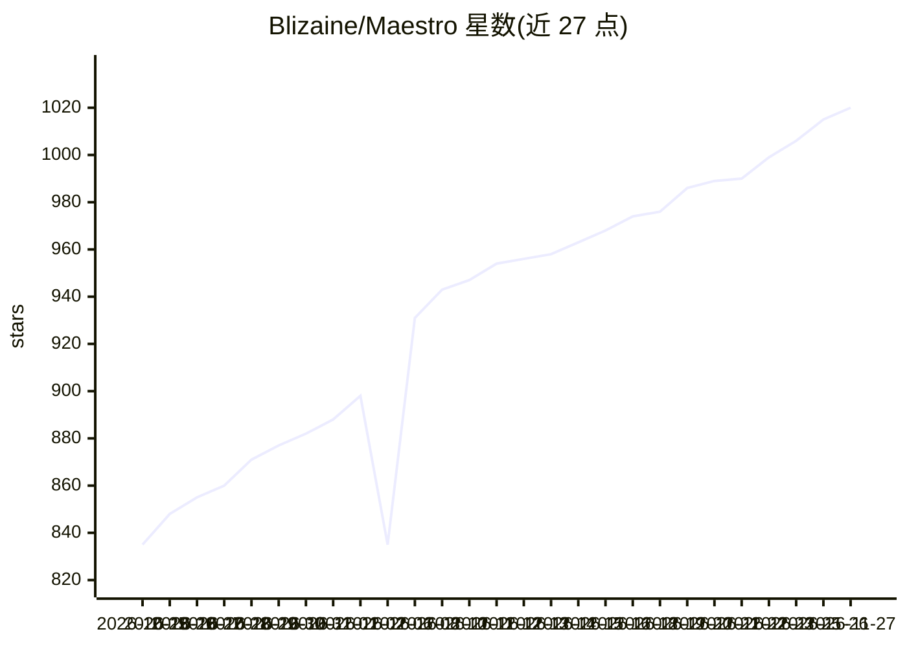

# Blizaine/Maestro

⭐ 1,020 · Python · NOASSERTION · 推送 2026-11-24 · [GitHub](https://github.com/Blizaine/Maestro) · [官网](https://pinokio.computer) · 个人维护

**面向创作者的本地 AI 视频/图像/音乐制作工作室**

Maestro 将图像、视频、音频生成、LLM 规划与多轨非破坏剪辑整合为一个本地运行的工作室，分 Studio（生成）、Director（从歌曲/故事生成镜头计划并成片）、Editor（时间线剪辑）三个模块。基于 WanGP 管线，本地模型在用户 PC 上运行，支持 MiniMax H3、LTX、Flux、Qwen 等模型；内置 MCP 供外部 agent 调用，可选接入 OpenAI、Anthropic、ComfyUI。通过 Pinokio 安装，支持手机/平板界面与 Tailscale 远程访问。

## 筛选速览

| 维度 | 判定 | 备注 |
|---|---|---|
| AI 角色 | `ai-native` | 本体是模型或模型工具 |
| 许可风险 | `none` | NOASSERTION |
| 部署形态 | `desktop` | 安装包/桌面程序 |
| 模型依赖 | local-ok | 支持本地模型 |
| 硬件要求 | `gpu-8g` | |
| 安装摩擦 | `medium` | 含编译或系统依赖之一 |
| 成熟度 | — | 结构信号不足 |

## 能力要点

- Director 模式从单曲提示生成完整音乐视频/短片的镜头计划
- Studio 支持 MiniMax H3、LTX、Flux、Qwen、MOSS、Fish Audio 等模型
- 内置 MCP 服务器，兼容 agent 可提交生成任务并管理项目
- Auto-Tune 依据 GPU/VRAM/RAM 自动匹配生成设置

## 适用场景

- 在一台本地 PC 上完成从提示词到成片的视频制作
- 本地生成图像、音乐、语音与克隆音色
- 把外部 AI agent 接入自己的生成工作流
- 用时间线编辑器剪辑并导出 AI 生成的片段

## 场景标签

`图像生成` `视频生成` `语音合成` · 领域:内容生成

## 证据(README 行号)

> L3: A one-click local AI **creative studio, director, and video editor** for creators. Maestro combines a modern interfa
> L11: Create with **Studio**, plan a production with **Director**, and finish it in the **Editor**. Local models run on y
> L16: - **Studio — video, images and audio.** Generate from text or references; animate, extend, blend and edit video; cr

## 星数曲线

2026-10-25 835 → 2026-11-27 1,020（+185）

---
*卡片 v1 · prompt 1.4 · 生成 2026-11-26 · 置信度 high · 依据 README sha `910614e65cdb` · [字段定义](../../DATASET.md)*
