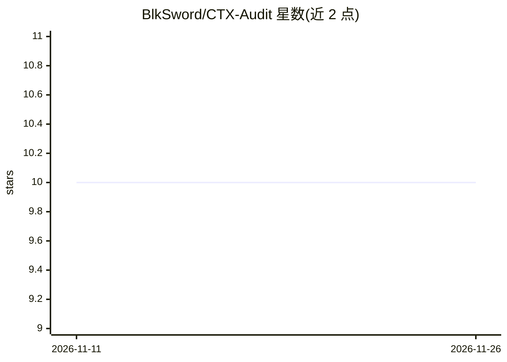

# BlkSword/CTX-Audit

⭐ 10 · Rust · Apache-2.0 · 推送 2026-11-25 · [GitHub](https://github.com/BlkSword/CTX-Audit) · [官网](https://github.com/BlkSword/CTX-Audit) · 个人维护 · 中文 README

**给 Rust/Java/Web 代码审计提供证据链的静态分析引擎，经 MCP 供 LLM 判定**

CTX-Audit 定位为代码安全事实引擎：确定性回答端点鉴权覆盖、入口到危险汇的可达路径、载荷存活状态等四类问题，输出带 provenance 与 uncertainty 的可复核证据。核心机制包括 PR 漂移闸门（block 判决+CI 退出码）、跨文件污点追踪、函数内 mini-SSA、受限动态验证（默认关闭、白名单目录）与五阶段审计工作流。通过 MCP 暴露 24+3 个工具供 Agent/LLM 取证，最终漏洞结论由 LLM 或人工给出；README 明确不宣称通用漏洞发现，且项目处于试验研发阶段。

## 筛选速览

| 维度 | 判定 | 备注 |
|---|---|---|
| AI 角色 | `ai-enhanced` | 去掉 AI 部分产品仍成立 |
| 许可风险 | `permissive` | Apache-2.0 |
| 部署形态 | `None` |  |
| 模型依赖 | — | README 未给出锁定关系 |
| 硬件要求 | — | 无带数字的原话,不猜 |
| 安装摩擦 | `medium` | 含编译或系统依赖之一 |
| 成熟度 | `idea` | |

## 能力要点

- PR 安全漂移闸门：new_unauthenticated_route 等判决类型，CI composite 一键 Action
- 候选链/链档带逐步行号、守卫与证伪命令，输出前经探针同口径校验
- MCP 工具面 24 个高阶工具+3 个基础工具，支持只读模式
- 受限动态验证支持 Python/Node/Java，仅限白名单 fixture 且默认关闭

## 适用场景

- 在 PR/CI 中拦截引入鉴权回归或新增危险汇的改动
- 让 Agent 通过 MCP 取证后做有依据的漏洞判定
- 生成带 curl/MockMvc 骨架与修复建议的可交付 PoC 工件
- 在 Web 控制台集中管理多仓库审计会话与证据台账

## 场景标签

`网络安全` `代码审查` · 领域:编码与开发

## 证据(README 行号)

> L21: CTX-Audit 是**事实引擎**，不是漏洞扫描器：
> L255: 默认 **24 个高阶工具 + 3 个基础工具（read_file / list_files / finish_analysis）**；遗留细粒度工具面需 `--legacy-tools` 或 `CTX_AUDIT_LEGACY

## 星数曲线

2026-11-11 10 → 2026-11-26 10（+0）

---
*卡片 v1 · prompt 1.4 · 生成 2026-11-20 · 置信度 high · 依据 README sha `5f76b56a6c66` · [字段定义](../../DATASET.md)*
