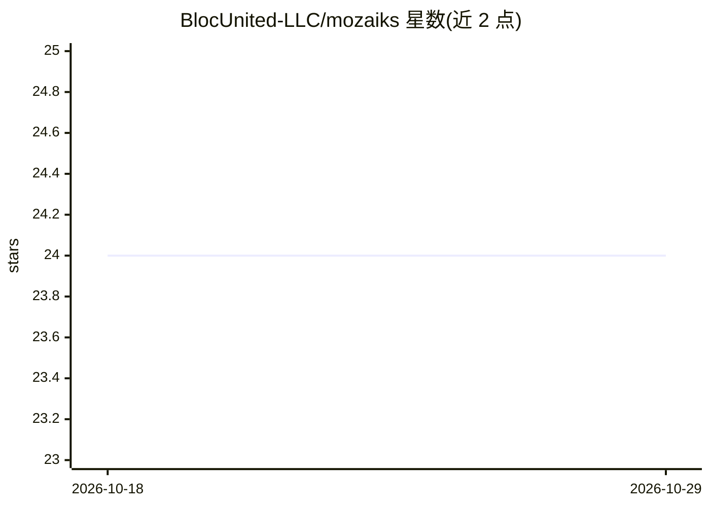

# BlocUnited-LLC/mozaiks

⭐ 24 · Python · MIT · 推送 2026-10-28 · [GitHub](https://github.com/BlocUnited-LLC/mozaiks) · 组织维护

**AI 应用工厂：生成、运行并迭代 AI 原生 Web 应用**

开源的 AI 应用工厂，供开发者构建、运行和迭代 AI 原生软件产品。包含用于创建和管理应用的 Studio、基于 AG2 的 AI 工作流编排，以及经严格契约校验的生成应用文件。应用生命周期分为 Genesis Build（首次构建）与 Refinement Run（增量修改）。运行时内置订阅权益门控、端口适配器（文件系统/S3/Docker）、租户隔离与带租约重试的工作流队列。当前构建仅调用 OpenAI API，需配置 MongoDB；生成的应用自托管、不依赖其托管平台。以 PyPI 包形式安装，需 Python 3.11+ 与 Node.js 20.19+/22.12+。

## 筛选速览

| 维度 | 判定 | 备注 |
|---|---|---|
| AI 角色 | `ai-ecosystem` | LLM/agent 周边工具 |
| 许可风险 | `permissive` | MIT |
| 部署形态 | `self-host` | docker 或自建部署 |
| 模型依赖 | — | README 未给出锁定关系 |
| 硬件要求 | — | 无带数字的原话,不猜 |
| 安装摩擦 | `low` | 无编译、无系统依赖或容器化 |
| 成熟度 | — | 结构信号不足 |

## 能力要点

- Genesis Build / Refinement Run 生命周期：增量修改不丢弃应用谱系
- YAML 契约经严格类型模型校验后才激活
- 运行时内置订阅→权益→功能门控、租户隔离与崩溃可恢复的工作流队列
- 端口适配器模式：可替换 S3/Docker/HTTP 等基础设施适配器

## 适用场景

- 通过 Studio 用自然语言描述并生成可部署的 AI 应用
- 在自有基础设施上自托管生成的多租户 AI Web 应用
- 对已有 AI 应用做增量迭代而不重建

## 场景标签

`Agent 框架` `多智能体` `代码生成` · 领域:Agent 开发

## 证据(README 行号)

> L17: Mozaiks is an open-source AI app factory for building, running, and iterating on
> L23: - **AI workflow orchestration powered by AG2** for planning, tool use, human

## 星数曲线

2026-10-18 24 → 2026-10-29 24（+0）

---
*卡片 v1 · prompt 1.4 · 生成 2026-10-27 · 置信度 mid · 依据 README sha `a85afb82ff6c` · [字段定义](../../DATASET.md)*
