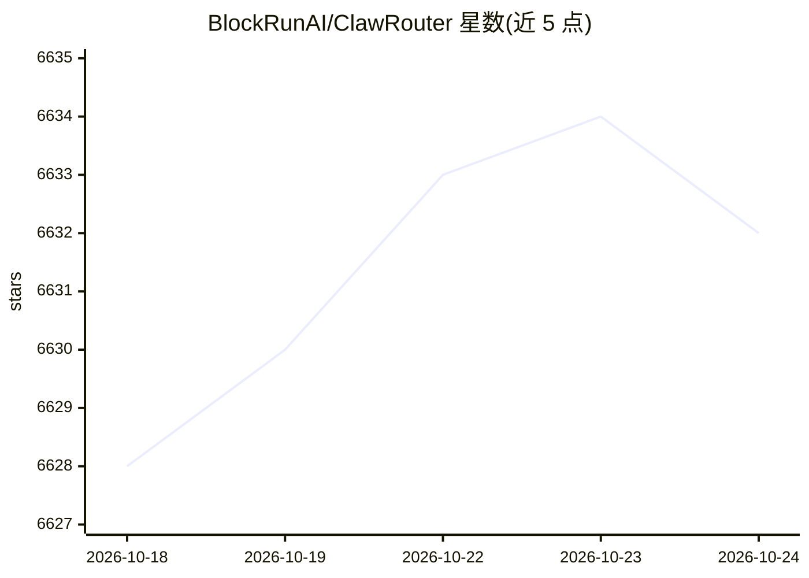

# BlockRunAI/ClawRouter

⭐ 6,633 · TypeScript · MIT · 推送 2026-10-22 · [GitHub](https://github.com/BlockRunAI/ClawRouter) · [官网](https://www.npmjs.com/package/@blockrun/clawrouter) · 组织维护

**面向自主 agent 的开源 LLM 路由器：本地路由+USDC 微支付**

ClawRouter 是 MIT 许可的智能 LLM 路由器，聚合 9 家提供商的 88 个聊天模型（另有图像/视频/语音与实时数据工具），在本地按 15 个维度打分、以约束优先排序为每个请求选择模型，路由延迟低于 1ms。面向自主 agent：无需账户和 API key，首次运行本地生成钱包，用 x402 协议在 Solana/Base 上按请求以 USDC 付费；也支持信用卡充值账户余额的 API key 方式，并提供 7 个免注册免费模型。可作为 OpenClaw 插件安装，或以本地代理（端口 8402）配合 Cursor、continue.dev 等 OpenAI 兼容客户端使用；macOS 另有 Electron 控制面板。计费依赖 BlockRun 网关。

## 筛选速览

| 维度 | 判定 | 备注 |
|---|---|---|
| AI 角色 | `ai-ecosystem` | LLM/agent 周边工具 |
| 许可风险 | `permissive` | MIT |
| 部署形态 | `library` | 以包/库形式分发 |
| 模型依赖 | locked-api |  |
| 硬件要求 | — | 无带数字的原话,不猜 |
| 安装摩擦 | `low` | 无编译、无系统依赖或容器化 |
| 成熟度 | — | 结构信号不足 |

## 能力要点

- 15 维本地评分+约束优先排序，路由延迟 <1ms，无外部 API 调用
- 88 个聊天模型来自 9 家提供商，统一端点与余额
- x402+USDC 按 agent 钱包签名逐请求付费（Solana/Base），或信用卡 API key
- 7 个模型免注册免密钥免费使用

## 适用场景

- 让自主 agent 自主支付并调用多家 LLM，无需人工注册账户
- 在 Cursor/continue.dev 等 OpenAI 兼容客户端中按请求自动选最便宜可用模型
- 以 7 个免费模型零成本试用或学习

## 场景标签

`模型网关` · 领域:Agent 开发

## 证据(README 行号)

> L33: > **ClawRouter** is an open-source smart LLM router that reduces AI API costs by up to 84 %. It analyzes each reque
> L48: **ClawRouter is how an agent reaches it.** BlockRun is the gateway and the billing; ClawRouter is the MIT-licensed 
> L61: - **No model selection** — 15 -dimension scoring + constraint-first ranking (router-core) picks the right model aut

## 星数曲线

2026-10-18 6,628 → 2026-10-24 6,632（+4）

---
*卡片 v1 · prompt 1.4 · 生成 2026-10-20 · 置信度 mid · 依据 README sha `943f382312b9` · [字段定义](../../DATASET.md)*
