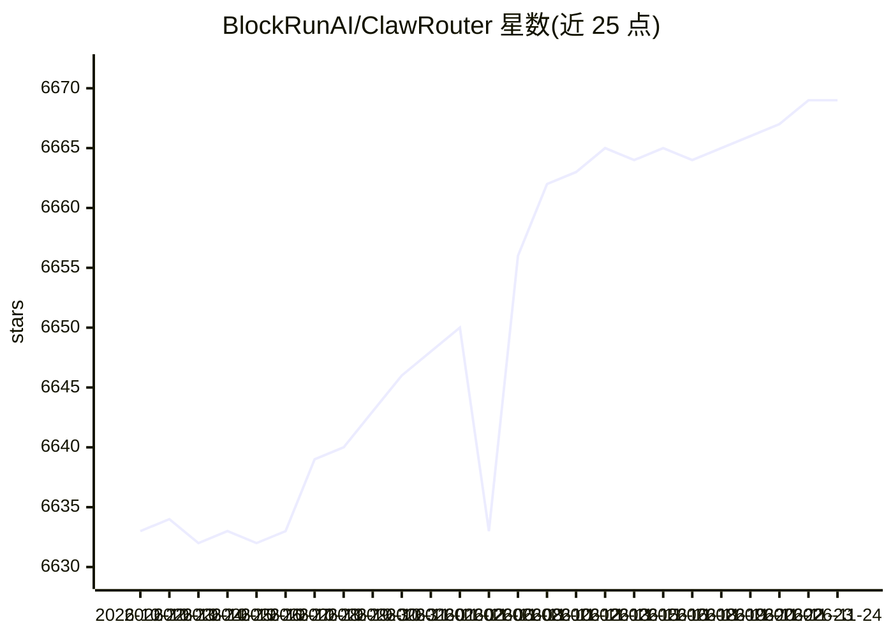

# BlockRunAI/ClawRouter

⭐ 6,670 · TypeScript · MIT · 推送 2026-11-23 · [GitHub](https://github.com/BlockRunAI/ClawRouter) · [官网](https://www.npmjs.com/package/@blockrun/clawrouter) · 组织维护

**面向自主 Agent 的本地 LLM 路由器，钱包签名即账号**

开源（MIT）LLM 智能路由器，本地运行、路由耗时低于 1ms，按 15 维评分将请求分配给可胜任的低价模型。面向无法注册账号、只能签交易的自主 Agent：本地生成钱包，通过 x402 协议以 USDC 按请求结算（Solana/Base），也支持信用卡注册充值换取 API key 的传统路径，另有 8 个免费模型无需任何注册。聚合 91 个聊天模型及图像、视频、语音等接口，可作为 OpenClaw 插件或本地代理（端口 8402）供 OpenAI 兼容客户端使用。

## 筛选速览

| 维度 | 判定 | 备注 |
|---|---|---|
| AI 角色 | `ai-ecosystem` | LLM/agent 周边工具 |
| 许可风险 | `permissive` | MIT |
| 部署形态 | `library` | 以包/库形式分发 |
| 模型依赖 | — | README 未给出锁定关系 |
| 硬件要求 | — | 无带数字的原话,不猜 |
| 安装摩擦 | `low` | 无编译、无系统依赖或容器化 |
| 成熟度 | — | 结构信号不足 |

## 能力要点

- 15 维本地评分路由，宣称低于 1ms 完成
- x402 + USDC 按请求结算，钱包签名即认证，无账号/密钥
- 8 个免费模型，无需注册、密钥或钱包
- Electron 桌面控制面板支持 OpenClaw/Codex 等一键接入

## 适用场景

- 让自主 Agent 自主付费调用 LLM 而无需人工注册账号
- 在 continue.dev、Cursor 等客户端通过本地代理按成本优选模型
- 降低多模型 API 调用支出

## 场景标签

`模型网关` · 领域:Agent 开发

## 证据(README 行号)

> L33: > **ClawRouter** is an open-source smart LLM router that reduces AI API costs by up to 84 %. It analyzes each reque
> L48: **ClawRouter is how an agent reaches it.** BlockRun is the gateway and the billing; ClawRouter is the MIT-licensed 
> L173: No OpenClaw required. ClawRouter runs as a local proxy on port 8402.

## 星数曲线

2026-10-22 6,633 → 2026-11-24 6,669（+36）

---
*卡片 v1 · prompt 1.4 · 生成 2026-11-24 · 置信度 mid · 依据 README sha `cf2c39062c98` · [字段定义](../../DATASET.md)*
