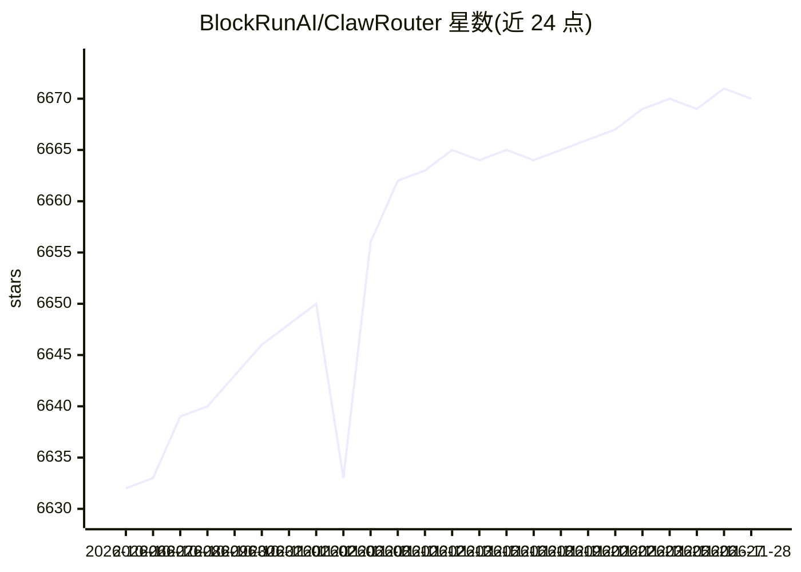

# BlockRunAI/ClawRouter

⭐ 6,670 · TypeScript · MIT · 推送 2026-11-24 · [GitHub](https://github.com/BlockRunAI/ClawRouter) · [官网](https://www.npmjs.com/package/@blockrun/clawrouter) · 组织维护

**面向自主 agent 的本地 LLM 路由器，钱包签名即账户**

ClawRouter 是一个 MIT 许可的开源 LLM 路由器（TypeScript/npm 包），运行在本地，按 15 维评分把请求路由到 91 个聊天模型，宣称路由耗时低于 1ms、无外部依赖。面向无法注册账号的自主 agent：本地生成钱包，以 x402 协议按请求支付 USDC（Solana/Base）；也支持信用卡充值 API key，以及 8 个免费模型免注册使用。可作为 OpenClaw 插件安装，或以本地代理（端口 8402）接入任意 OpenAI 兼容客户端；另有 macOS Electron 桌面控制面板。

## 筛选速览

| 维度 | 判定 | 备注 |
|---|---|---|
| AI 角色 | `ai-ecosystem` | LLM/agent 周边工具 |
| 许可风险 | `permissive` | MIT |
| 部署形态 | `library` | 以包/库形式分发 |
| 模型依赖 | — | README 未给出锁定关系 |
| 硬件要求 | — | 无带数字的原话,不猜 |
| 安装摩擦 | `low` | 无编译、无系统依赖或容器化 |
| 成熟度 | — | 结构信号不足 |

## 能力要点

- 本地 15 维评分智能路由，路由到 91 个模型（9 个供应商）
- x402 协议 USDC 微支付，钱包签名即认证，无需账号
- 8 个免费模型开箱即用，无需注册、密钥或钱包
- 提供 OpenClaw 插件与本地 OpenAI 兼容代理（端口 8402）

## 适用场景

- 让自主 agent 自主为 LLM 调用付费而无需人工注册
- 在 continue.dev/Cursor 等 IDE 工具中接入智能路由
- 按请求成本优化：每个请求路由到能胜任的最便宜模型

## 场景标签

`模型网关` · 领域:Agent 开发

## 证据(README 行号)

> L33: > **ClawRouter** is an open-source smart LLM router that reduces AI API costs by up to 84 %. It analyzes each reque
> L48: **ClawRouter is how an agent reaches it.** BlockRun is the gateway and the billing; ClawRouter is the MIT-licensed 
> L173: No OpenClaw required. ClawRouter runs as a local proxy on port 8402.

## 星数曲线

2026-10-26 6,632 → 2026-11-28 6,670（+38）

---
*卡片 v1 · prompt 1.4 · 生成 2026-11-26 · 置信度 mid · 依据 README sha `1dac96f3582e` · [字段定义](../../DATASET.md)*
