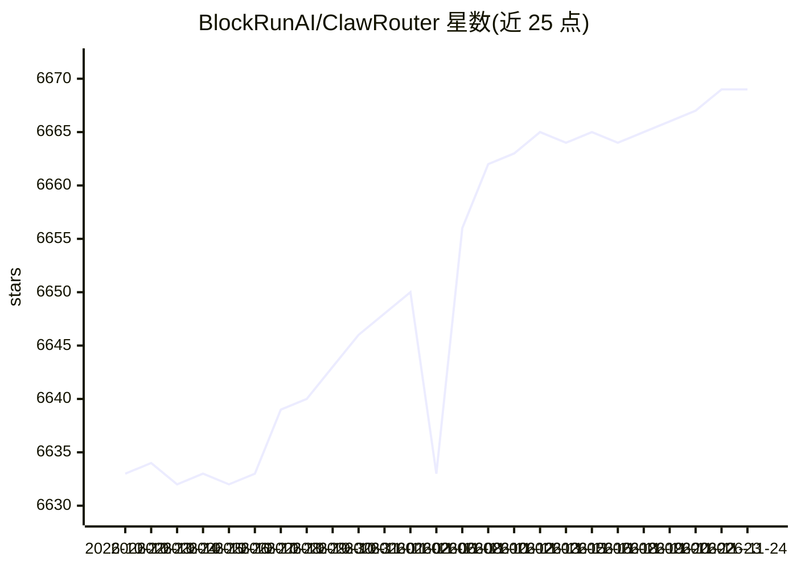

# BlockRunAI/ClawRouter

⭐ 6,669 · TypeScript · MIT · 推送 2026-11-21 · [GitHub](https://github.com/BlockRunAI/ClawRouter) · [官网](https://www.npmjs.com/package/@blockrun/clawrouter) · 组织维护

**面向自主 agent 的本地 LLM 路由器，支持钱包签名与 USDC 支付**

ClawRouter 是一个 MIT 许可的开源 LLM 路由器，以本地代理形式运行（默认端口 8402），在本地按 15 维度对请求评分并在 1ms 内选择模型，覆盖 91 个聊天模型及图像、视频、语音等 API。认证方式为本地生成钱包、以 x402 协议的 USDC 每请求结算（Solana/Base），也可通过 user.blockrun.ai 注册并用信用卡充值获取 API key；另有 8 个免费模型无需注册即可使用。安装方式为 npm 全局包，可作为 OpenClaw 插件或独立代理对接 continue.dev、Cursor 及 OpenAI 兼容客户端，macOS 另有 Electron 桌面控制面板。

## 筛选速览

| 维度 | 判定 | 备注 |
|---|---|---|
| AI 角色 | `ai-ecosystem` | LLM/agent 周边工具 |
| 许可风险 | `permissive` | MIT |
| 部署形态 | `library` | 以包/库形式分发 |
| 模型依赖 | — | README 未给出锁定关系 |
| 硬件要求 | — | 无带数字的原话,不猜 |
| 安装摩擦 | `low` | 无编译、无系统依赖或容器化 |
| 成熟度 | — | 结构信号不足 |

## 能力要点

- 15 维度本地评分路由，1ms 内选择模型，无需外部依赖
- 钱包签名即认证，x402 协议 USDC 按请求结算（Solana/Base），也支持信用卡 API key
- 8 个免费模型无需注册、key 或钱包即可使用
- 提供 OpenClaw 插件安装路径、独立本地代理与 macOS Electron 控制面板

## 适用场景

- 给自主 agent 配置免注册的模型调用与按请求付费通道
- 在 continue.dev/Cursor 等客户端接入统一的多模型路由端点
- 通过自动选模型降低 API 调用支出

## 场景标签

`模型网关` · 领域:Agent 开发

## 证据(README 行号)

> L33: > **ClawRouter** is an open-source smart LLM router that reduces AI API costs by up to 84 %. It analyzes each reque
> L48: **ClawRouter is how an agent reaches it.** BlockRun is the gateway and the billing; ClawRouter is the MIT-licensed 
> L173: No OpenClaw required. ClawRouter runs as a local proxy on port 8402.

## 星数曲线

2026-10-22 6,633 → 2026-11-24 6,669（+36）

---
*卡片 v1 · prompt 1.4 · 生成 2026-11-23 · 置信度 mid · 依据 README sha `548736452bae` · [字段定义](../../DATASET.md)*
