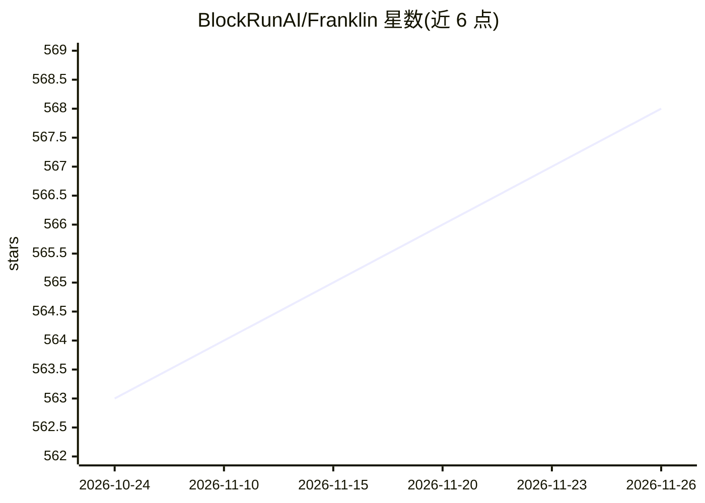

# BlockRunAI/Franklin

⭐ 568 · TypeScript · Apache-2.0 · 推送 2026-11-23 · [GitHub](https://github.com/BlockRunAI/Franklin) · [官网](https://franklin.run) · 组织维护

**持有 USDC 钱包的自主经济 Agent，按结果付费执行交易与研究**

由 BlockRun 团队开发的自主经济 Agent，以 npm 包分发，运行于 Node.js 20.19+。它持有用户自控的 USDC 钱包，通过 x402 微支付协议为模型调用、市场数据、搜索与媒体生成付费；交易为旗舰场景，交易计划需用户批准后才执行。提供两种付费通道：钱包（无需注册）或预充值 API key。支持从 97 个模型中按任务选择，内置钱包绑定的交易日志与跨会话目标。另有 VS Code 扩展与 macOS/Windows 桌面 Beta 版。

## 筛选速览

| 维度 | 判定 | 备注 |
|---|---|---|
| AI 角色 | `ai-native` | 本体是模型或模型工具 |
| 许可风险 | `permissive` | Apache-2.0 |
| 部署形态 | `desktop` | 安装包/桌面程序 |
| 模型依赖 | — | README 未给出锁定关系 |
| 硬件要求 | — | 无带数字的原话,不猜 |
| 安装摩擦 | `low` | 无编译、无系统依赖或容器化 |
| 成熟度 | — | 结构信号不足 |

## 能力要点

- USDC 钱包 + x402 微支付，按动作链上结算，钱包即身份
- YOPO 定价：聊天按提供商成本零加价、+$0.001/次，无订阅无速率上限
- 从 97 个模型中按任务路由，交易计划需用户批准
- CLI、VS Code 扩展与桌面版共享 ~/.blockrun/ 配置与历史

## 适用场景

- 设定预算让 Agent 自主购买数据并生成交易计划
- 无订阅方式按结果付费调用多个前沿模型与工具
- 在终端与 VS Code 间共享钱包和会话记录使用同一 Agent

## 场景标签

`金融量化` · 领域:学习与行业

## 证据(README 行号)

> L32: Franklin Agent is an **autonomous economic agent** — an AI that holds a USDC wallet and spends it to get real work 
> L84: The same agent ships as a VS Code extension — chat panel, model picker, wallet balance, image / video generation — 
> L101: |Platform|Current beta package|

## 星数曲线

2026-10-24 563 → 2026-11-26 568（+5）

---
*卡片 v1 · prompt 1.4 · 生成 2026-11-25 · 置信度 high · 依据 README sha `7d3da90de59d` · [字段定义](../../DATASET.md)*
