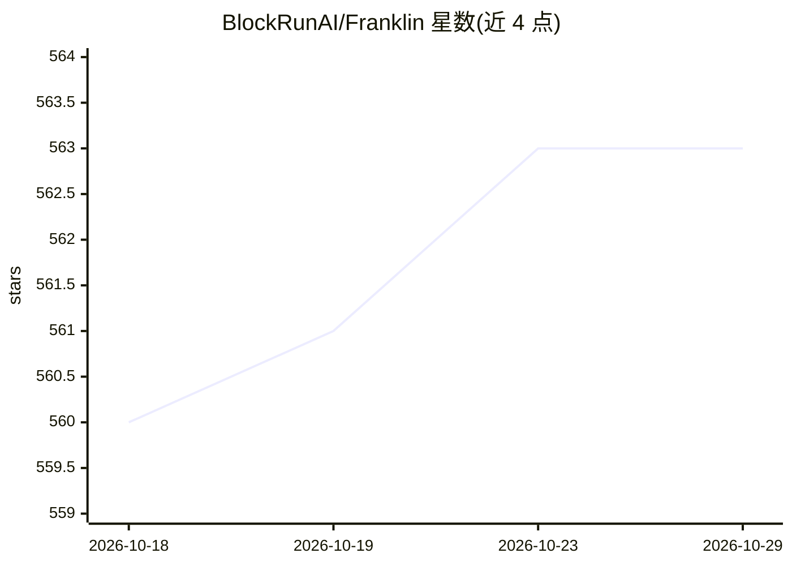

# BlockRunAI/Franklin

⭐ 563 · TypeScript · Apache-2.0 · 推送 2026-10-28 · [GitHub](https://github.com/BlockRunAI/Franklin) · [官网](https://franklin.run) · 组织维护

**持有 USDC 钱包的自主 AI agent：自行付费完成交易与研究任务**

由 BlockRun 团队开发的自主经济型 agent，以 TypeScript/npm 包交付，含 CLI 与 Beta 版桌面端（macOS/Windows）及 VS Code 扩展。它持有用户资助的 USDC 钱包（Solana/Base/Arc，经 x402 微支付协议按调用链上结算），或用预付费 API key，自行购买模型调用、行情数据、搜索与媒体生成，按任务从 88 个模型中选型；交易计划需用户批准后执行，钱包余额为硬性支出上限。聊天花费为按 token 估算值，其余调用记录实际结算额。

## 筛选速览

| 维度 | 判定 | 备注 |
|---|---|---|
| AI 角色 | `ai-native` | 本体是模型或模型工具 |
| 许可风险 | `permissive` | Apache-2.0 |
| 部署形态 | `desktop` | 安装包/桌面程序 |
| 模型依赖 | — | README 未给出锁定关系 |
| 硬件要求 | — | 无带数字的原话,不猜 |
| 安装摩擦 | `low` | 无编译、无系统依赖或容器化 |
| 成熟度 | `idea` | |

## 能力要点

- USDC 钱包经 x402 按调用链上结算，钱包即身份、无需注册
- 按任务从 88 个模型中选型，统一接入各付费 API
- 交易计划需用户批准，钱包余额为硬性预算上限（无透支）
- YOPO 计费：聊天按提供商成本加 $0.001/次，媒体加 5%

## 适用场景

- 设定预算与目标，让 agent 执行交易、研究等长程任务
- 用一个钱包统一支付多家模型与付费 API，按用量付费
- 在 VS Code 或桌面端用同一钱包继续 CLI 会话

## 场景标签

`金融量化` `科研工具` · 领域:学习与行业

## 证据(README 行号)

> L32: Franklin Agent is an **autonomous economic agent** — an AI that holds a USDC wallet and spends it to get real work 
> L34: Funding it is your choice. Fund a **USDC wallet** and every paid action routes through the x402 micropayment protoc

## 星数曲线

2026-10-18 560 → 2026-10-29 563（+3）

---
*卡片 v1 · prompt 1.4 · 生成 2026-10-21 · 置信度 high · 依据 README sha `35e6e1afb12c` · [字段定义](../../DATASET.md)*
