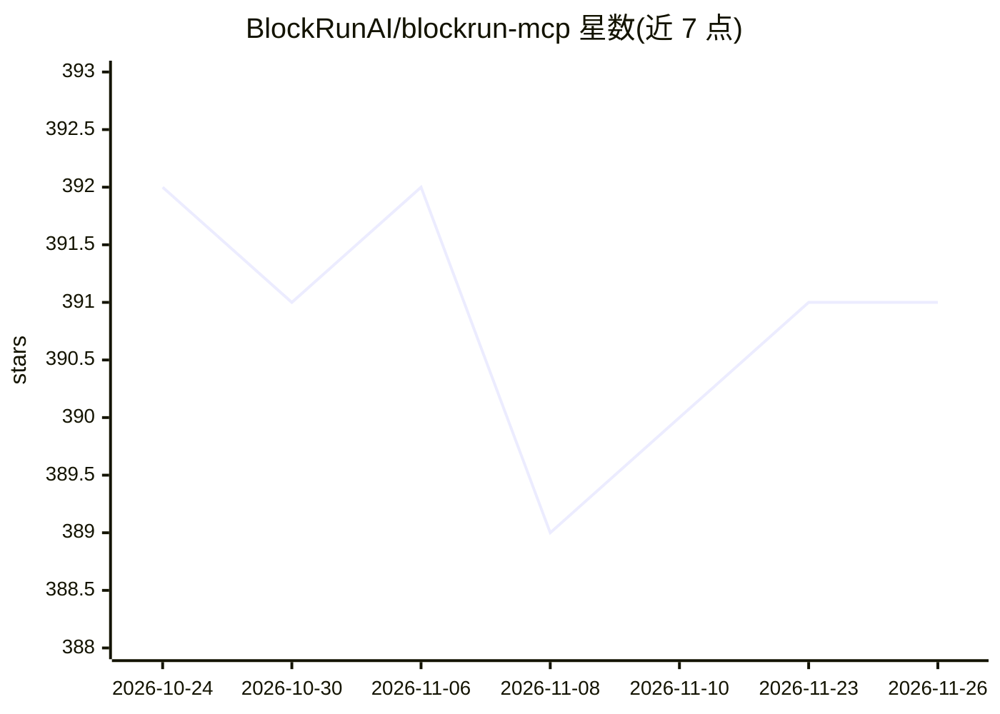

# BlockRunAI/blockrun-mcp

⭐ 391 · TypeScript · MIT · 推送 2026-11-24 · [GitHub](https://github.com/BlockRunAI/blockrun-mcp) · [官网](https://www.npmjs.com/package/@blockrun/mcp) · 组织维护

**给 AI agent 提供实时数据与交易工具的 MCP 服务器，按调用付费**

开源 Model Context Protocol 服务器，为 Claude 及任何 MCP 兼容 agent 提供 19 个工具：91 个 LLM 接入、图像/视频生成、实时网页与新闻搜索、40 条链上数据查询、预测市场（Polymarket）读数与下单交易。支付方式两种：自托管钱包以 USDC 经 x402 协议按调用结算，或使用 BlockRun API key 走账户信用扣费。支持消费前人工确认（BLOCKRUN_CONFIRM_SPEND）与预算上限（BLOCKRUN_BUDGET_LIMIT），MIT 许可，通过 npx/npm 安装。

## 筛选速览

| 维度 | 判定 | 备注 |
|---|---|---|
| AI 角色 | `ai-ecosystem` | LLM/agent 周边工具 |
| 许可风险 | `permissive` | MIT |
| 部署形态 | `library` | 以包/库形式分发 |
| 模型依赖 | — | README 未给出锁定关系 |
| 硬件要求 | — | 无带数字的原话,不猜 |
| 安装摩擦 | `low` | 无编译、无系统依赖或容器化 |
| 成熟度 | — | 结构信号不足 |

## 能力要点

- 19 个工具：LLM、图像/视频生成、网页搜索、链上数据、Polymarket 交易
- 钱包签名即认证，按调用以 USDC 经 x402 结算，无需注册
- 消费前确认与 per-agent 预算限制等人机协同支付机制
- 在 Claude Code、Codex CLI、OpenClaw 等多客户端验证安装路径

## 适用场景

- 让 agent 查询实时行情、新闻与链上数据并按调用付费
- 在 Claude Code 中读取 Polymarket 赔率并下真实订单
- 团队通过 API key 与账户信用统一为 agent 支付数据调用费用

## 场景标签

`视频生成` `图像生成` `金融量化` · 领域:内容生成

## 证据(README 行号)

> L42: > **BlockRun MCP** is an open-source Model Context Protocol server that gives Claude — and any MCP-compatible agent
> L44: You pay per call, and you choose how. **Wallet mode** authenticates with a signature and settles each call in USDC 
> L125: **Every MCP client** — one command or one JSON block. *Verified* = we ran the published package on that client and

## 星数曲线

2026-10-24 392 → 2026-11-26 391（-1）

---
*卡片 v1 · prompt 1.4 · 生成 2026-11-26 · 置信度 high · 依据 README sha `7c84f397bf79` · [字段定义](../../DATASET.md)*
