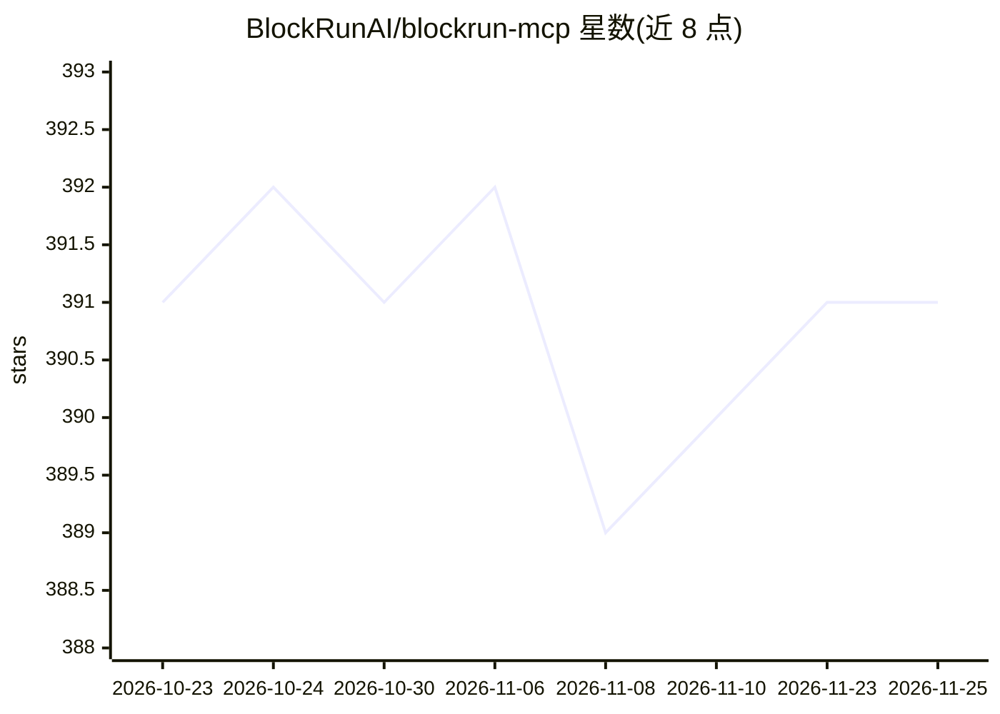

# BlockRunAI/blockrun-mcp

⭐ 391 · TypeScript · MIT · 推送 2026-11-23 · [GitHub](https://github.com/BlockRunAI/blockrun-mcp) · [官网](https://www.npmjs.com/package/@blockrun/mcp) · 组织维护

**给 AI agent 供实时数据与 Polymarket 交易的付费 MCP 服务器**

一个开源（MIT）的 Model Context Protocol 服务器，为 Claude 及任何兼容 MCP 的 agent 提供 19 个工具：91 个 LLM 调用、图像/视频生成、网页与新闻搜索、40 条链上数据查询、预测市场行情读取与真实下单。付费走两条通道：自托管钱包以 x402 协议按调用结算 USDC（无需账户与 API key），或 BlockRun API key 走账户扣费。支持每笔付费调用前的人工确认（MCP elicitation）与预算上限；通过 npx/npm 安装，需 Node 运行时。

## 筛选速览

| 维度 | 判定 | 备注 |
|---|---|---|
| AI 角色 | `ai-ecosystem` | LLM/agent 周边工具 |
| 许可风险 | `permissive` | MIT |
| 部署形态 | `library` | 以包/库形式分发 |
| 模型依赖 | — | README 未给出锁定关系 |
| 硬件要求 | — | 无带数字的原话,不猜 |
| 安装摩擦 | `low` | 无编译、无系统依赖或容器化 |
| 成熟度 | `idea` | |

## 能力要点

- 19 个工具：LLM 调用、图像/视频生成、搜索、链上数据、Polymarket 交易
- 钱包模式经 x402 协议按调用以 USDC 结算，无需账户与信用卡
- 付费调用前人工确认（BLOCKRUN_CONFIRM_SPEND）与 BLOCKRUN_BUDGET_LIMIT 预算护栏
- 在 Claude Code、Codex CLI、OpenClaw 等多个 MCP 客户端上验证可用

## 适用场景

- 让 agent 读取实时 Polymarket 赔率并在确认后下单
- 给 agent 提供按次付费的网页搜索与新闻检索
- 查询多链 DEX 行情与加密货币价格
- 通过 MCP 为 agent 接入图像/视频生成能力

## 场景标签

`视频生成` `金融量化` · 领域:内容生成

## 证据(README 行号)

> L42: > **BlockRun MCP** is an open-source Model Context Protocol server that gives Claude — and any MCP-compatible agent
> L7:  BlockRun MCP gives your agent 19 tools — markets, research, web search, images, video, on-chain data, and live Poly

## 星数曲线

2026-10-23 391 → 2026-11-25 391（+0）

---
*卡片 v1 · prompt 1.4 · 生成 2026-11-25 · 置信度 high · 依据 README sha `97deb648e38c` · [字段定义](../../DATASET.md)*
