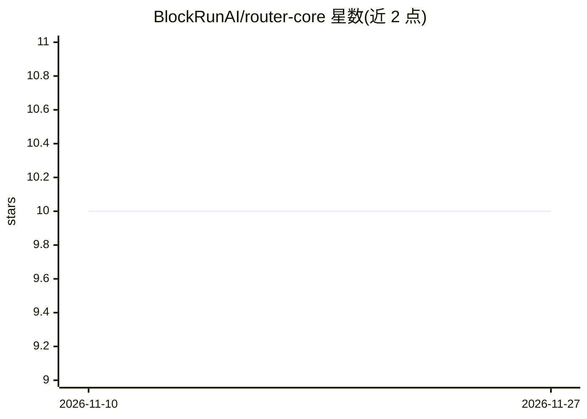

# BlockRunAI/router-core

⭐ 10 · TypeScript · MIT · 推送 2026-11-24 · [GitHub](https://github.com/BlockRunAI/router-core) · [官网](https://blockrun.ai/clawrouter) · 组织维护

**给 LLM 应用与 agent 的本地确定性模型路由引擎**

一个被 ClawRouter、Franklin、Hermes、dsh-clawrouter 等六个包共享的模型选择引擎：对每个请求按 15 个本地维度分类，先做硬性能力过滤（工具调用、视觉、上下文窗口、输出容量等），再按任务契合、成本、速度、可靠性对幸存模型排序，返回胜者与有序回退链。决策在本机约 0.05–0.25 ms 内完成，无推理调用、无网络访问、结果确定且可解释（含 tier、taskType、candidateScores、reasoning）。该包不发布到 npm，需通过 GitHub commit tarball 安装，要求 Node ≥ 20.19，零运行时依赖。

## 筛选速览

| 维度 | 判定 | 备注 |
|---|---|---|
| AI 角色 | `ai-ecosystem` | LLM/agent 周边工具 |
| 许可风险 | `permissive` | MIT |
| 部署形态 | `library` | 以包/库形式分发 |
| 模型依赖 | — | README 未给出锁定关系 |
| 硬件要求 | — | 无带数字的原话,不猜 |
| 安装摩擦 | `low` | 无编译、无系统依赖或容器化 |
| 成熟度 | — | 结构信号不足 |

## 能力要点

- 约束优先：硬性能力过滤先于打分，无法满足契约的模型被提前剔除
- 本地确定性决策，约 0.05 ms，零网络调用与零运行时依赖
- 每个决策附带 tier/taskType/confidence/candidateScores/reasoning，88 请求快照进 CI 防漂移
- 提供逐行 Python 移植以保持跨语言决策一致

## 适用场景

- 为多模型 agent 自动选择每次请求应使用的模型
- 在遵守能力硬约束的前提下按 eco/auto/premium 策略控制调用成本
- 构建需要决策可审计、可复现的路由层

## 场景标签

`模型网关` · 领域:Agent 开发

## 证据(README 行号)

> L28: > **`@blockrun/router-core`** is a **smart LLM router** — an automatic model selector that decides which model shou
> L30: > It is deliberately product-neutral. There is no wallet, no gateway client, no proxy server, no agent loop, no pay
> L63: |**ClawRouter**|Direct dependency. `src/router/index.ts` is a single `export * from "@blockrun/router-core"` — the 

## 星数曲线

2026-11-10 10 → 2026-11-27 10（+0）

---
*卡片 v1 · prompt 1.4 · 生成 2026-11-20 · 置信度 mid · 依据 README sha `3c0ffb11d038` · [字段定义](../../DATASET.md)*
