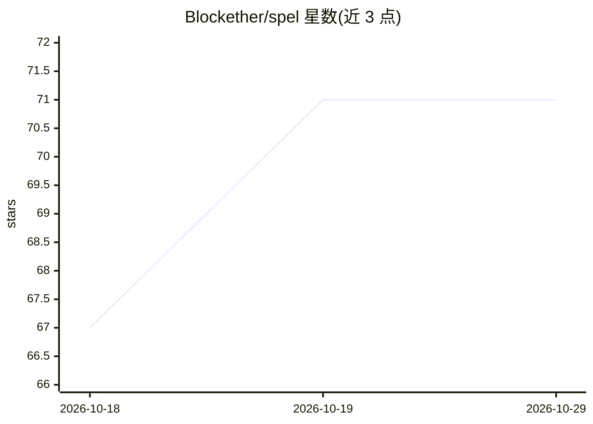

# Blockether/spel

⭐ 71 · Clojure · Apache-2.0 · 推送 2026-10-26 · [GitHub](https://github.com/Blockether/spel) · [官网](https://blockether.github.io/spel/) · 组织维护

**终端控制真实浏览器的 CLI 工具：自动化、抓取与 E2E 测试**

基于 Playwright Java、以 Clojure 封装的命令行工具：通过 shell 命令打开页面、点击、填表、截图、读取页面内容并转为 Markdown；支持 Chromium/Firefox/WebKit 三种引擎。以单一自包含二进制（约 71MB）分发，后台守护进程维持持久浏览器会话，命令间复用。提供带编号的 accessibility snapshot 定位元素、会话录制并自动生成 Clojure 测试、Allure 报告与 HTTP 流量拦截断言。可作为 Clojure 库（Clojars）或原生 CLI 使用，支持并行多会话与 CI 无头运行。

## 筛选速览

| 维度 | 判定 | 备注 |
|---|---|---|
| AI 角色 | `ai-ecosystem` | LLM/agent 周边工具 |
| 许可风险 | `permissive` | Apache-2.0 |
| 部署形态 | `library` | 以包/库形式分发 |
| 模型依赖 | — | README 未给出锁定关系 |
| 硬件要求 | — | 无带数字的原话,不猜 |
| 安装摩擦 | `low` | 无编译、无系统依赖或容器化 |
| 成熟度 | — | 结构信号不足 |

## 能力要点

- 单一自包含二进制，无需 Node.js/npm 依赖
- 后台守护进程维持持久浏览器会话，命令间复用
- accessibility snapshot 以编号引用元素，替代 CSS 选择器
- 会话录制生成 Clojure 测试，附 Allure 报告与网络检查

## 适用场景

- 从终端或脚本自动化浏览器操作与内容抓取
- 为 AI agent/编程工具提供浏览器控制通道
- 编写并运行带 Allure 报告的 E2E 测试（含 CI 无头模式）

## 场景标签

`浏览器自动化` `网页抓取` · 领域:效率与自动化

## 证据(README 行号)

> L26: **spel is a command-line tool that controls a real browser.** You type commands in your terminal, and spel opens pa
> L67: spel wraps Playwright Java with idiomatic Clojure: maps for options, anomaly maps for errors, `with-*` macros for l
> L43: **Why not just use Claude Code's `--chrome` / browser MCP tools?**

## 星数曲线

2026-10-18 67 → 2026-10-29 71（+4）

---
*卡片 v1 · prompt 1.4 · 生成 2026-10-24 · 置信度 low · 依据 README sha `d76a0f78682a` · [字段定义](../../DATASET.md)*
