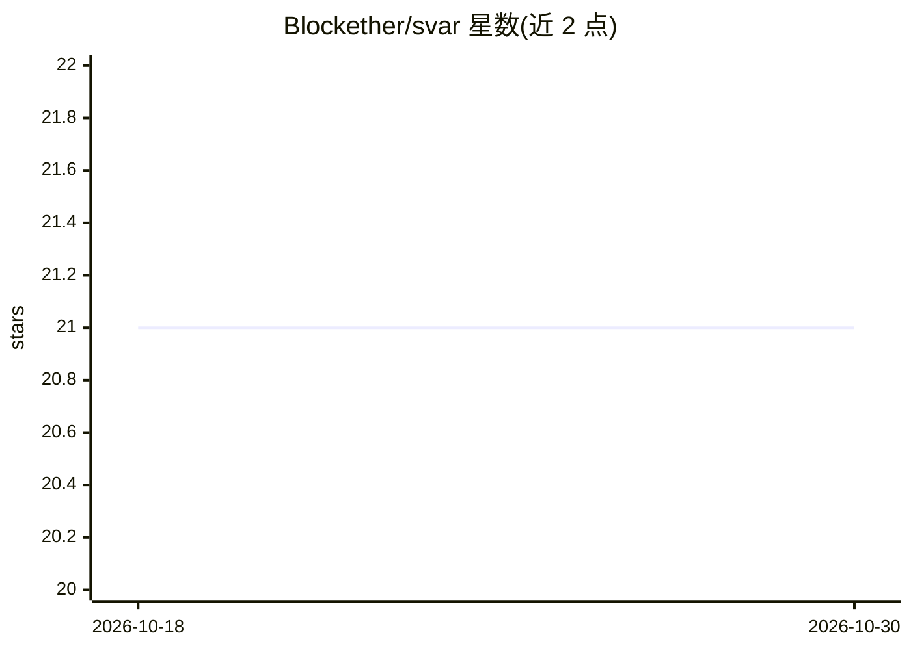

# Blockether/svar

⭐ 21 · Clojure · Apache-2.0 · 推送 2026-10-27 · [GitHub](https://github.com/Blockether/svar) · 个人维护

**Clojure 库：从任意文本 LLM 获得类型安全的结构化输出**

面向 Clojure 开发者的 LLM 客户端库：核心思路是不要求模型端支持结构化输出模式，而是让模型输出纯文本 JSON，再用基于 Java 的 SAP 解析器（容忍畸形 JSON、未加引号的键、尾逗号、markdown 代码块）在事后解析并按 spec 校验，从而兼容任意文本生成 LLM（OpenAI、Anthropic、Ollama、vLLM 等）。提供多提供商路由器，含断路器、成本预算、自动降级回退与 prompt-cache 遥测；另含原生工具调用（ask-code!）、OpenAI Codex 有状态 WebSocket 会话、spec DSL 与 token/成本估算（JTokkit）。通过 Clojars 以 deps.edn 依赖安装。

## 筛选速览

| 维度 | 判定 | 备注 |
|---|---|---|
| AI 角色 | `ai-ecosystem` | LLM/agent 周边工具 |
| 许可风险 | `permissive` | Apache-2.0 |
| 部署形态 | `None` |  |
| 模型依赖 | — | README 未给出锁定关系 |
| 硬件要求 | — | 无带数字的原话,不猜 |
| 安装摩擦 | `low` | 无编译、无系统依赖或容器化 |
| 成熟度 | — | 结构信号不足 |

## 能力要点

- SAP 事后解析：无需模型端 JSON 模式即可获得 spec 校验的 Clojure map
- 多提供商路由：断路器、成本预算、自动回退、prompt-cache 遥测
- 原生工具调用 ask-code!：按 Anthropic/OpenAI/Gemini 各 wire 适配，支持 :strict 语法约束
- Codex 有状态会话：WebSocket 长连接、增量回合、55 分钟轮换与 HTTP 回退

## 适用场景

- 在 Clojure 项目中让任意文本 LLM 稳定返回结构化数据
- 跨多个 LLM 提供商做带预算与回退的路由
- 为本地或小众模型补齐结构化输出与工具调用能力

## 场景标签

`模型网关` · 领域:Agent 开发

## 证据(README 行号)

> L18: SVAR takes a different approach: let the LLM produce plain text, then parse and correct the output post-step. This 
> L25: |**Structured Output**|`ask!`|LLM → validated Clojure map via spec. Works with any text-producing LLM — SAP parser 

## 星数曲线

2026-10-18 21 → 2026-10-30 21（+0）

---
*卡片 v1 · prompt 1.4 · 生成 2026-10-28 · 置信度 high · 依据 README sha `d94b98aac7fd` · [字段定义](../../DATASET.md)*
